# ABW — Low-Level Systems Design

**Agent Bestiary Workspace: components, physical data flows, CQRS reality, provenance, verification, extension surfaces, and gaps**

| | |
|---|---|
| Audience | Senior systems engineers (written with a C++ background in mind; Rust idioms are mapped in [Appendix A](#appendix-a--rust--c-mental-model)) |
| Baseline | `main` @ `a3cea516` (2026-10-08) **plus the uncommitted working tree**: migrations `240_agent_versions_whole_card.sql` and `241_episodes_produced_by_version.sql`, and `docs/architecture/ABW Verification Lattice — Specification v0.1.md`, are untracked; `src/api_server.rs`, `agent-bestiary/memory/src/store.rs`, `src/handlers/agents.rs` and others are modified |
| Method | Read-only code traces, with the highest-severity findings re-checked line by line (see [Appendix C](#appendix-c--method-and-confidence)) |
| Status | Descriptive. Says what the code **does**, not what the design docs intend. Where the two disagree, the code wins and the disagreement is listed |

**Evidence legend**

- **[V]**: verified by reading the cited code or SQL.
- **[I]**: inference. The reasoning is given, but the behaviour was not executed or fully traced.
- **[D]**: stated in a document only, with no code counterpart found.

Citations use `path:line` relative to the repo root. Line numbers drift, so treat them as anchors, not contracts.

---

## Contents

0. [Ten facts to hold in your head](#0-ten-facts-to-hold-in-your-head)
1. [Physical architecture](#1-physical-architecture)
2. [What an agent is, physically](#2-what-an-agent-is-physically)
3. [The hot path: executing an agent](#3-the-hot-path-executing-an-agent)
4. [State, writes and reads: the CQRS audit](#4-state-writes-and-reads-the-cqrs-audit)
5. [Provenance](#5-provenance)
6. [Verification](#6-verification)
7. [How CQRS, provenance and verification interact](#7-how-cqrs-provenance-and-verification-interact)
8. [Extension surfaces](#8-extension-surfaces)
9. [Gap register](#9-gap-register)
10. [Target-state sketch (proposal, not code)](#10-target-state-sketch-proposal-not-code)
- [Appendix A: Rust → C++ mental model](#appendix-a--rust--c-mental-model)
- [Appendix B: file index](#appendix-b--file-index)
- [Appendix C: method and confidence](#appendix-c--method-and-confidence)
- [Appendix D: documentation drift](#appendix-d--documentation-drift)

---

## 0. Ten facts to hold in your head

1. **One process.** ABW is one async Rust binary, `api-server`, running Axum 0.7 on a tokio multi-thread runtime. It talks to one Postgres database (Neon, pgvector) through one 25-connection pool. Workspace "files" are local libgit2 repositories on the container's disk.
2. **An agent is a value, rows, and a pipeline.**
   - The value is an in-memory `AgentCard`, a plain config struct, merged per request from a JSON file and DB columns.
   - The rows are one `agents` row, a history in `agent_versions`, and a stream of `episodes` (one per run).
   - The pipeline is a bounded tool-calling LLM loop.
3. **ABW is not CQRS and not event-sourced.** Canonical state is mutable tables updated in place: about 335 `UPDATE` sites in production Rust, about 16 explicit transactions, and no event store, stream version, aggregate, or replay. Logs are written *after* mutations and are not folded back into state.
4. **A few CQRS-shaped islands exist.**
   - `assertion_verifications`, `gate_decision_reviews` and `forecast_agent_claims` are append-only by convention.
   - Their current state is derived at read time with `DISTINCT ON (...) ORDER BY created_at DESC`.
   - Only `episode_corrections` and `hitl_actions` are DB-enforced, and only against `UPDATE`, not `DELETE`.
5. **Provenance is four unrelated mechanisms, with no chain.** They are embedding provenance, episode authority, grounding verdicts, and artifact hashes. They are joined by nullable UUID back-pointers, most of which are deliberately *not* foreign keys. The `ΞPROV` chain-walk in the Lattice spec does not exist.
6. **Verification is a family of "trust contracts", not the spec's Lattice.**
   - Each contract (`schema_trust`, `gate_trust`, `grounding_trust`, `liveness_trust`, …) is a `const` declaration table plus a classifier, and they share no trait.
   - The code's 5-rung **ladder** reuses the Lattice's five dimension names (Presence, Liveness, Truth, Grounding, Binding) for *different* questions. Only Grounding means roughly the same thing in both.
7. **Grounding grades plausibility, not proof.** `tool_verified` means "a field that a tool *could* have supplied is populated". The grader never sees the tool calls (`src/grounding_trust.rs:5494`).
8. **Gate decisions reach the database by write-behind.** They go to an in-memory queue, which a recorder task flushes every 15 s; at 4096 entries the oldest are dropped. They are never in the same transaction as the effect they gated.
9. **Only one unit on the execute path is atomic:** the episode row together with its embedding-provenance sidecar (`agent-bestiary/memory/src/store.rs:306-458`). Everything else is an autocommit statement, a detached task, or a process-local counter. That includes money: the wallet `UPDATE` and the ledger `INSERT` are separate statements.
10. **Extensions are compile-time.** You extend ABW by implementing `PlatformTool`, `EvalModel` or `Feed` in this repository and recompiling. At runtime you can only:
    - declare remote MCP servers per agent,
    - deploy App manifests (JSON),
    - call agents over A2A or the per-agent MCP JSON-RPC endpoint.

---

## 1. Physical architecture

### 1.1 Deployment topology

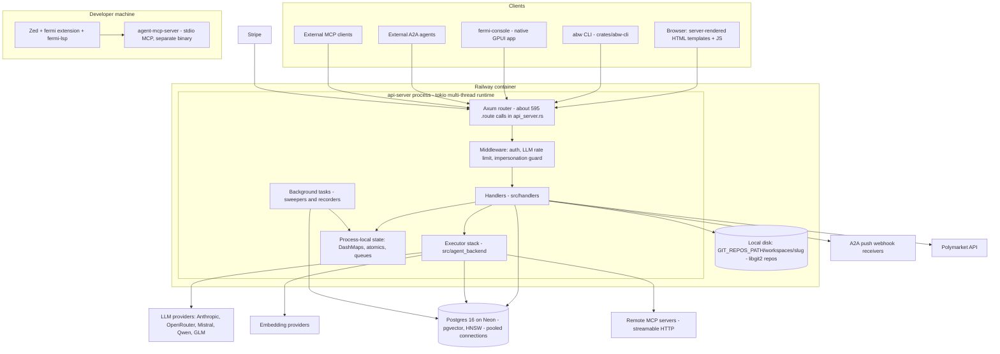

**Physical facts:**

- **One binary** serves the JSON API, the HTML pages and the background sweepers. It runs SQL migrations at boot. Railway auto-deploys from `main` [D: `docs/architecture/OVERVIEW.md`].
- **The connection pool** (`src/api_server.rs:2340-2359`) [V]:
  - `max_connections(25)`, `min_connections(2)`, `acquire_timeout(30s)`
  - `statement_cache_capacity(0)` and `DISCARD ALL` after connect. Both are the usual settings behind a transaction-mode pooler; they imply PgBouncer-style pooling [I, corroborated by the comment at `fermi-auth/src/credits.rs:227`].
- **Git storage.** Each workspace is a libgit2 repo at `{GIT_REPOS_PATH or ./repos}/workspaces/{slug}/` (`src/api_server.rs:2513`, `agent-bestiary/ontology/src/workspace_git.rs:40-56`, `git2 0.19` with vendored libgit2) [V].
  - **This is container-local disk.** With more than one replica, or with ephemeral disks, workspace files would diverge or vanish [I].
- **No queue, no cache tier, no read replica.** Postgres is the only shared state. Everything else lives in the process.

### 1.2 Workspace crate map

| Crate | Path | Role |
|---|---|---|
| `fermi` (lib + bins) | `.` | API server, handlers, executor stack, trust contracts, the FPL language (lexer/parser/AST/Monte Carlo executor) |
| `agent-bestiary-memory` | `agent-bestiary/memory` | "ADM" store: all SQL for episodes, rules, entities, facts, communities, embeddings, consolidation, locking, the provenance-oracle trait |
| `agent-bestiary-ontology` | `agent-bestiary/ontology` | Ontology snapshots, git-backed workspace manager (`WorkspaceGitManager`) |
| `agent-bestiary-projector` | `agent-bestiary/projector` | PCA/t-SNE dimensionality reduction, plus a DashMap cache with a 5-minute TTL. **Not** a CQRS projector |
| `agent-bestiary-evaluators` | `agent-bestiary/evaluators` | `EvalModel` trait, registry, aggregator, LLM judge |
| `evaluator-{wildguard,faithfulness,sotopia,lifelong,character}` | `agent-bestiary/evaluator-*` | Native evaluator plugins |
| `agent-bestiary-observability` | `agent-bestiary/observability` | Drift, anomaly and trend scoring |
| `agent-bestiary-coherence-gate` | `agent-bestiary/coherence-gate` | Coherence gate (Γ ≥ θ), two-write memory pattern |
| `coherence-{core,engine,observer,api,protocols}` | `agent-bestiary/coherence/crates/*` | Multi-agent settling engine |
| `agent-bestiary-consolidate` | `agent-bestiary/consolidate` | Standalone consolidation ("dreaming") binary |
| `fermi-auth` | `fermi-auth` | OAuth2, JWT, API keys, SIWE stub, wallets and credits, teams, visibility |
| `fermi-lsp` | `fermi-lsp` | Language server for FPL |
| `abw-cli`, `abw-apps-core` | `crates/*` | Developer CLI; pure App-manifest validator shared by CLI and server |
| `simops`, `posterior`, `posterior-reg`, `projections`, `dynamics` | `crates/*` | Simulation, Bayesian fitting, Monte Carlo projection, ODE dynamics |
| `fermi-console`, `fermi-activity` | `crates/*` | Native GPUI client; in-memory UI activity ring buffer |

### 1.3 Binaries

| Binary | Purpose |
|---|---|
| `api-server` (`src/api_server.rs`, about 7.6k lines) | The platform |
| `fermi` (`src/main.rs`) | FPL CLI [I] |
| `agent-mcp-server` (`src/bin/agent-mcp-server.rs`) | stdio MCP server for editors. It loads agents from `$AGENTS_DIR` and takes provider keys from the environment |
| `migrate-embedding-dimensions`, `backfill-embedding-provenance`, `embedding-anchors`, `brier-backtest-seed`, `initialize-workspace`, `contract-sketch`, `input-contract-sketch` | Operational scripts |
| `resim_wc`, `apply_wc_cascades` | One-off backfills [I] |

### 1.4 Process-wide state (`AppState`, `src/api_server.rs:433-501`) [V]

`AppState` is cloned into every handler through `State<AppState>`. Every field is either `Clone`-cheap (`Arc`, pool handle, channel sender) or small config.

```rust
struct AppState {
    db: PgPool,                                   // the one pool
    memory_store: Arc<MemoryStore>,               // wraps the same pool; all ADM SQL
    registry: Arc<AgentRegistry>,                 // in-memory card index
    projection_engine, projection_cache,          // PCA/t-SNE + DashMap(300s TTL)
    embedder: Arc<dyn EmbeddingGenerator>,        // provider chosen at boot
    workspace_git: Arc<WorkspaceGitManager>,      // libgit2 repos on disk
    gemini_api_key, jwt_secret, oauth, gas_fees: GasFees, stripe, email, rate_limits,
    ws_broadcast, rabble_broadcast, creature_broadcast: broadcast::Sender<_>,
    secret_encryptor: Option<Arc<SecretEncryptor>>,   // AES-256-GCM
    export_consent: Arc<DashMap<..>>,                 // 5-minute TTL
    pg_notify: broadcast::Sender<(String, String)>,   // fan-out of one shared PgListener
    posterior_cache: Arc<DashMap<Uuid, ConditionalPosterior>>,
    extractor_registry, feed_registry,
    brier_lookup: Arc<dyn BrierLookup>,
}
```

**State that lives only in this process.** All of it changes meaning if you run more than one replica [I]:

| State | Where | Consequence with N replicas |
|---|---|---|
| LLM rate-limit windows | DashMap, `src/api_server.rs:112` | Effective limit becomes N × the configured limit |
| Gate counters `APPROVED/REFUSED/UNDETERMINED: [AtomicU64; 10]` | `src/gate_trust.rs:445-447` | Each replica reports a partial view |
| Gate decision queue (cap 4096) | `src/gate_trust.rs:478-480` | Lost on crash, per replica |
| Write-accounting counters | `src/write_accounting.rs:327-332` | Reset on restart; partial view |
| Latest liveness report | `static LATEST: OnceLock<RwLock<..>>`, `src/liveness_trust.rs:914` | Differs per replica; never persisted |
| Agent usage stats (`record_execution`) | `AgentRegistry` | Never persisted; lost on restart |
| `posterior_cache`, `projection_cache`, `export_consent` | DashMaps | Cache incoherence |

### 1.5 Boot sequence

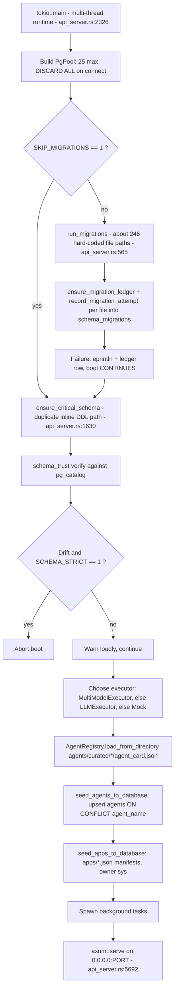

The exact interleaving of registry load, seeding and task spawns is approximate [I]. The line anchors are [V].

**Background tasks spawned at boot** (`src/api_server.rs:2573-2763`) [V]:

| Task | Cadence | Writes |
|---|---|---|
| Shared `PgListener` | Continuous | Fans out `pg_notify` broadcast |
| `polymarket::spawn_resolution_sweeper` | Periodic | Forecast resolutions |
| `forecast_git::spawn_history_reconciler` | Periodic | Forecast history in git |
| `live_observability::spawn_observability_sweeper` | Periodic | Observability signals |
| `liveness_trust::spawn_liveness_sweeper` | Hourly, first run 120 s after boot | In-memory report only |
| `gate_trust::spawn_gate_recorder` | Every 15 s | `gate_decisions` (batched `UNNEST` insert) |
| `consolidation::spawn_consolidation_sweeper` | **Off by default** (`CONSOLIDATION_SWEEP_SECS=0`) | Rules, entities, facts, snapshots |
| Rate-limiter cleanup | Every 300 s | Memory |

---

## 2. What an agent is, physically

### 2.1 Definition

An **agent** is the following tuple. Each element has a distinct physical home:

| Element | Physical form | Mutability |
|---|---|---|
| **Identity** | `agents` row (`agent_id uuid`, unique `agent_name`, `user_id` owner or NULL for system/curated, `tier`, status, economics) | Mutable in place |
| **Declaration** | `AgentCard` struct: `agents/curated/<name>/agent_card.json` overlaid with DB columns | File is read at boot; DB overlay is applied per request |
| **History** | `agent_versions` rows (snapshot of DB columns per edit) | Append-only by convention; no hash; cascade-deleted with the agent |
| **Behaviour record** | `episodes` rows, one per run, plus `embedding_provenance` | Upserted once from `running`, then patched by later `UPDATE`s |
| **Memory** | `semantic_rules`, `entities`, `facts`, `communities`, `ontology_snapshots`, produced by consolidation | Mutable |
| **Economics** | `wallets` row(s), `credit_ledger` | Wallet is canonical and mutable; the ledger is a denormalised copy |
| **Runtime** | `ToolAwareExecutor` → provider HTTP → tools | Stateless per request |

**Mental model.** An agent is a **configuration object with a persistent audit trail**, not an actor with a mailbox. There is no long-lived agent process, thread or queue. "Running an agent" means: build a value-type card, run a bounded loop of up to 5 LLM turns plus one flush turn inside the request's async task, and write one episode.

### 2.2 The card type (`src/agent_backend/agent_card.rs`) [V]

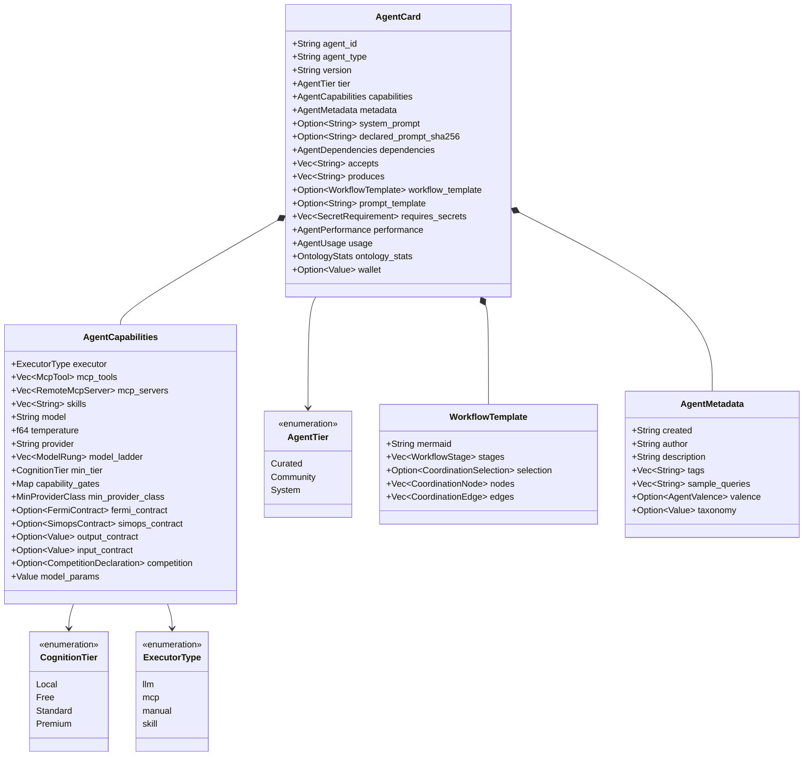

**Load-time behaviour:**

- `AgentCard::from_json` (`:902-921`) normalises legacy fields (`:940-966`), then calls `stamp_declared_prompt()`. That stores **bare-hex SHA-256** of `system_prompt` in `declared_prompt_sha256` (`:809-816`). This field is `skip_serializing`: it exists only in memory.
- That hash is the **only content hash of agent configuration in the system**. It reaches persistence only indirectly, as `episodes.context->>'card_prompt_hash'` (`src/episodes.rs:280`).

**Tier resolution** (`apply_tier_resolution`, `:629-655`):

- `CognitionTier` derives `Ord` from declaration order: `Local < Free < Standard < Premium`.
- The highest `model_ladder` rung with `rung.tier ≤ requested` wins.
- On `POST /api/agents/:id/execute` the requested tier is always `None`, so the ladder is **not applied** on that path [V].

**Sampling** (`resolve_sampling_params`, `:661-699`):

- `model_params` keys override the legacy `temperature` field.
- `extended_thinking` forces `temperature = 1.0`.

### 2.3 Card resolution: file × DB merge

`resolve_agent_card(state, db_agent) -> AgentCard` (`src/api_server.rs:6877-6978`) returns **by value**. Every request gets its own copy of the card.

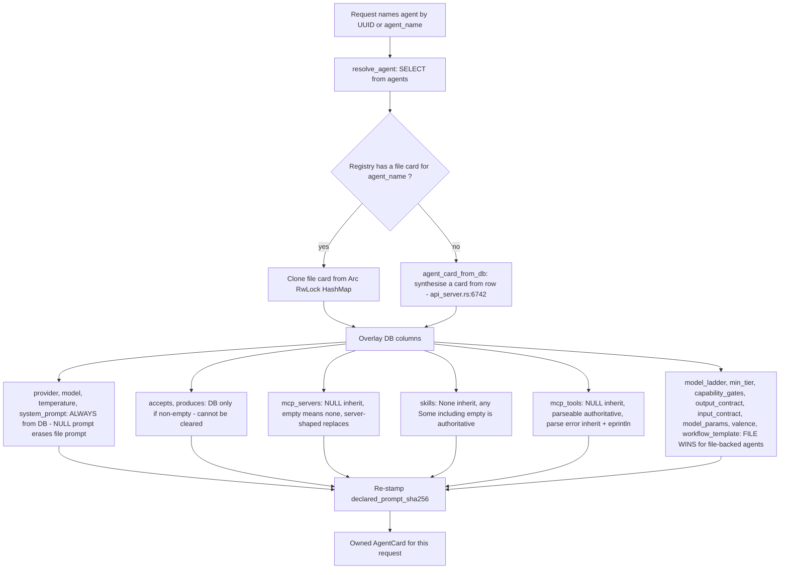

**Three consequences:**

1. **The boot seeder overwrites edits to curated agents.** `MemoryStore::upsert_agent` sets `system_prompt/model/temperature/mcp_servers = EXCLUDED.*` (`agent-bestiary/memory/src/store.rs:693-697`), and the seeder passes `mcp_servers: None` (`src/api_server.rs:5858`) [V]. Every restart resets these columns from the file, and writes no `agent_versions` row for the reset.
2. **`agent_versions` does not describe what actually ran.** It snapshots DB columns. For file-backed agents, the contract, ladder and sampling fields that actually ran came from the file (O6 above).
3. **There is no single source of truth for "the agent's configuration".** The effective card is a merge computed at request time and is never persisted. The closest approximation is the hash of the prompt.

### 2.4 Versions (migrations 024, 126, 240, 241) [V]

```sql
-- 024 + 126 + 240 (abridged)
agent_versions(
  version_id uuid PK, agent_id uuid FK -> agents ON DELETE CASCADE,
  version_number int NOT NULL,            -- NO UNIQUE(agent_id, version_number)
  system_prompt, model, temperature, tags text[], visibility, display_alias, changed_by,
  model_ladder, capability_gates, min_tier, output_contract, version_string,      -- 126
  llm_provider, model_params, accepts, produces, input_contract, skills,           -- 240
  mcp_servers, mcp_tools, requires_secrets, valence, competition,
  prompt_template, workflow_template, taxonomy,
  created_at)
-- 241
ALTER TABLE episodes ADD produced_by_version_id uuid REFERENCES agent_versions ON DELETE SET NULL,
                     ADD produced_by_version_number int;
```

**How a version is written.** `create_agent_version` (`store.rs:1192-1213`) is a single `INSERT … SELECT` from `agents` with `version_number = COALESCE(MAX, 0) + 1`. Its two callers (`handlers/agents.rs:2401-2416`, `:3286-3297`) run `update_agent`, **then** `create_agent_version(...).await.ok()`.

| Property | Status |
|---|---|
| Atomic with the edit | **No.** These are two statements, and a failed version write is swallowed by `.ok()` |
| Unique number | **No.** There is no unique constraint, and `MAX+1` without a lock races [I] |
| Content-addressed | **No.** There is no hash column |
| Immutable | By convention only: no trigger, and a FK cascade deletes the history with the agent |
| Episode stamp | Derived by a correlated subquery **at episode write time**, not at run start (`store.rs:339-344`). An edit during a run stamps the new version [I] |

### 2.5 The tool surface an agent actually gets

- **Every agent is offered every LLM-visible platform tool.** The executor builds the tool list in this order: all LLM-visible `PlatformTool`s, then card `mcp_tools` that have schemas, then the agent's remote MCP tools. Name collisions are resolved first-come-first-served (`src/agent_backend/tools/registry.rs:120-162`) [V].
- **Card `mcp_tools` is an *export* allowlist** (what ABW publishes over MCP). It is **not** an allowlist of tools the agent may call.
- There are 107 `PlatformTool` implementations across 17 domain files (`tools/domains/*`) [V].
- Registry variants:
  - `standard()`: no workspace tools, no delegation tools. Used on `/execute`.
  - `all()`: used on workspace messages.
  - `workspace_no_delegation()`: used for delegated children. This caps delegation depth at 1.

**Skills.** A skill name is "executable" only if it **exactly** matches `SkillRegistry::names()`. Anything else silently becomes a taxonomy label, so a typo is not an error. `PUT /api/agents/:id` rejects only case-mismatches (`normalise_skills`) [D: `docs/AGENT_MODEL.md` §1.2.1b; V for the registry location `tools/mod.rs:415, 809-857`]. A second, orphaned skills module exists at `tools/skills/mod.rs` and is never compiled (no `mod skills;`) [V].

### 2.6 The agent as an FPL AST node

The FPL forecasting language's AST includes `AgentStmt { name, agent_type, query, executor: Option<ExecutorType>, schedule, driver_refs, depends_on, confidence_threshold }` (`src/ast.rs:247-256`). This same struct is the **runtime invocation type** for workspace chat (`handlers/workspace/messages.rs:521`) and for the stdio MCP server (`agent-mcp-server.rs:436`) [V].

So the language AST is shared with the execution API. Changing that AST node is an ABI change for agent invocation.

### 2.7 Core entity-relationship model (execution-relevant subset)

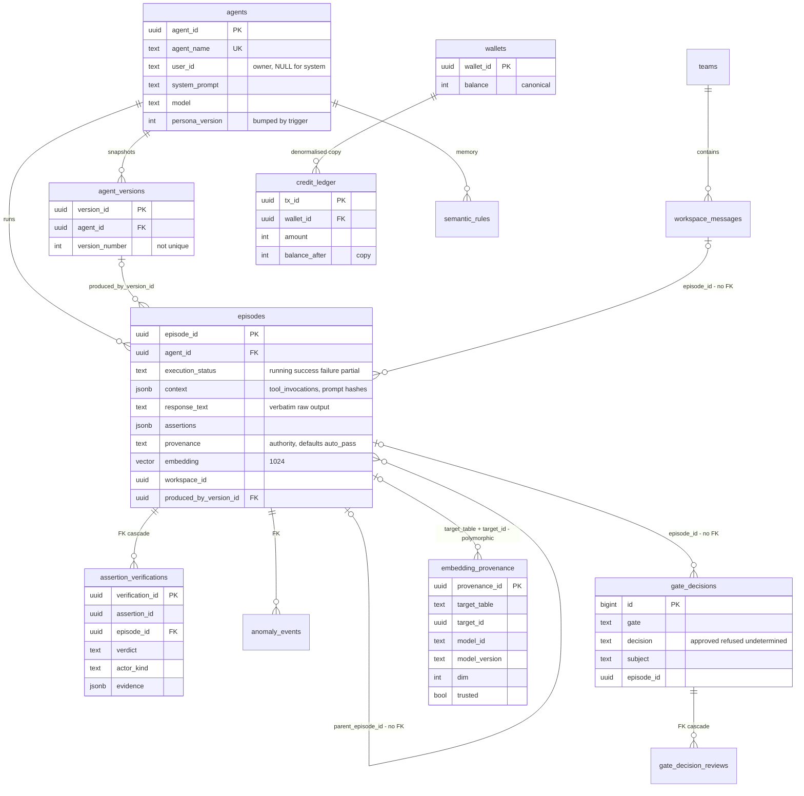

---

## 3. The hot path: executing an agent

### 3.1 `POST /api/agents/:agent_id/execute`, step by step

Handler: `handlers::execution::execute_agent_handler` (`src/handlers/execution.rs`; route at `src/api_server.rs:3908-3911`) [V]. The numbered sequence below follows the request frame by frame. Read it top to bottom as a timeline.

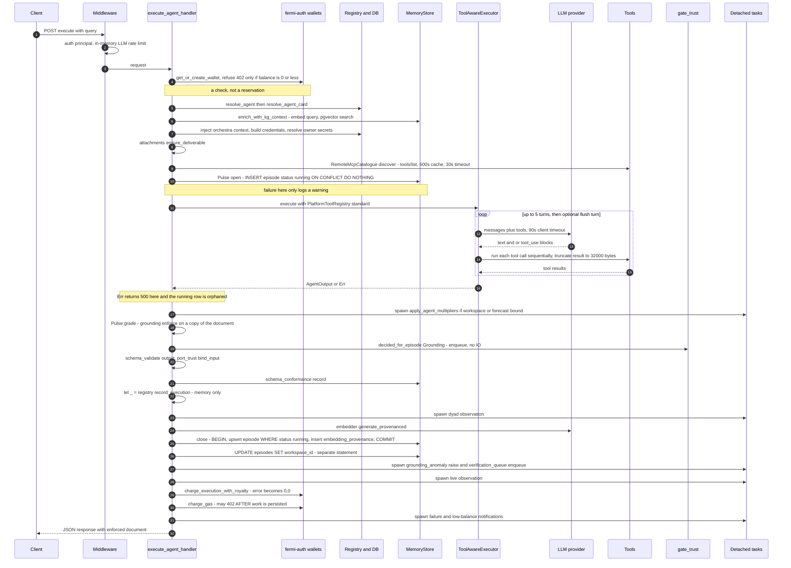

**Each step and what happens when it fails:**

| # | Step | I/O | Persisted | On failure |
|---|---|---|---|---|
| 2 | LLM rate limit | Memory | No | 429 |
| 4 | Wallet pre-check | 1 SELECT, maybe INSERT | Wallet row | 402 if `balance <= 0`. A time-of-check/time-of-use race against concurrent spends |
| 5–8 | Card, KG, orchestra, credentials, attachments | Several SELECTs, 1 embedding HTTP call | No | Mostly degrade to "no context" |
| 9 | Remote MCP discovery | HTTP per server, sequential | Cache (600 s) | Tools absent |
| 10 | `Pulse::open` | 1 INSERT | `episodes(status='running')` | Warning. The run continues with an unreserved id |
| 11–15 | Executor loop | 1–6 LLM calls, N tool calls | No | `Err` → 500. **The `running` row is orphaned** |
| 17 | Grounding grade | CPU | No (gate decision is queued) | Cannot fail |
| 21 | `record_execution` | Memory | **Never** | Swallowed (`let _ =`) |
| 23 | Embedding | HTTP | — | `None`: the episode is stored without an embedding |
| 24 | `close` | **1 transaction** | `episodes` + `embedding_provenance` | Error is logged and counted |
| 25 | `workspace_id` patch | 1 UPDATE | `episodes.workspace_id` | Separate from the transaction |
| 28 | Execution fee + royalty | 2+ UPDATE/INSERT pairs | `wallets`, `credit_ledger` | Downgraded to `(0,0)`. **The run becomes free** |
| 29 | Gas | UPDATE + INSERT | `wallets`, `credit_ledger` | Returns 402 **after** the episode is persisted |

### 3.2 The executor loop state machine

`ToolAwareExecutor::execute` (`src/agent_backend/tool_executor.rs:906-956`) picks a path:

- **Bypass** to a single-turn `inner.execute` if the card is tagged `meta-agent`, or if `prompt_demands_structured_output()` matches. That heuristic includes the bare substring `"ONLY"` (`:109`).
- `execute_anthropic_loop` for provider `anthropic` or an empty provider.
- `execute_openai_loop` otherwise.

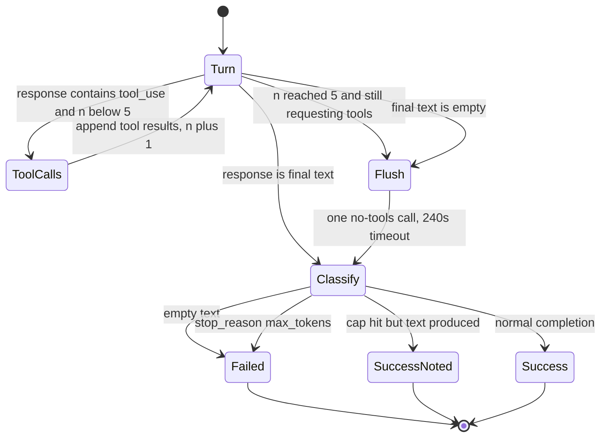

**Constants and limits** [V]:

| Limit | Value | Location |
|---|---|---|
| `MAX_ITERATIONS` | 5 | `tool_executor.rs:27` |
| Per-turn HTTP timeout | 90 s, shared `reqwest` client | `:139-142` |
| `FLUSH_TIMEOUT_SECS` | 240 s, Anthropic path only | `:60` |
| Tool result cap | 32 000 **bytes**, sliced as `&output[..32_000]` | `:331-336` |
| Tool concurrency within a turn | Sequential, awaited one by one | `:309-346` |
| Retries | **None** anywhere in `agent_backend` | grep |
| Overall request deadline | **None**: no `tokio::time::timeout` or `TimeoutLayer` | grep |

**Hazards on this path:**

- **UTF-8 panic.** `&output[..32_000]` slices a `String` by byte offset. If byte 32 000 falls inside a multi-byte UTF-8 sequence, the task panics. The C++ analogy is `substr` on UTF-8 followed by a validating constructor that throws.
- **Unbounded latency.** Worst-case wall time is about 5 × 90 s + 240 s of LLM time, plus tool time, with no cap [I].
- **Attachments dropped.** The tool loop sends `MessageContent::Text` only and never reads `context.attachments`. Images survive only on the bypass path [V].

### 3.3 Episode lifecycle

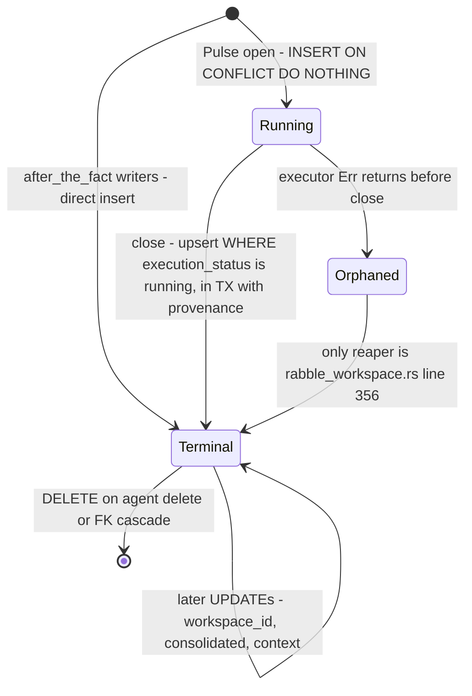

- **Guard.** `WHERE episodes.execution_status = 'running'` (`store.rs:381`) is the only thing stopping a finished episode from being rewritten. There is no trigger [V].
- **Reader panic.** `ExecutionStatus::from_str` accepts only `success | failure | partial` (`agent-bestiary/memory/src/types.rs:363-374`). Readers call `.parse().unwrap()` (`store.rs:591-593`), so **any `SELECT` that returns a `running` row panics the calling task** [V].
  - `get_unconsolidated_episodes` filters only on `NOT consolidated`, so it can return such rows.
  - A panic inside a spawned sweeper kills that task. Its consolidation lock is then held until the TTL expires [I].

### 3.4 Workspace invocation (`POST /api/workspaces/:id/messages`) differences

| Aspect | `/execute` | Workspace message |
|---|---|---|
| When the agent runs | Inside the request | **After the HTTP response.** The whole execution is `tokio::spawn`ed (`messages.rs:344`) |
| Tool registry | `standard()` | `all()` |
| Remote MCP | Discovered | **`remote_mcp: None`.** The agent's remote tools are unavailable |
| Required secrets | Resolved from the owner | Resolved from the **caller** (`messages.rs:432-441`) |
| Rate limited | Yes (`LLM_SPEND_ROUTES`) | **No.** The path is not in the list (`api_server.rs:244-263`) [V] |
| Execution fee | Soft-fail | **`let _ =`**: fully swallowed (`messages.rs:718-727`) |
| Result message write | n/a | `let _ = store_workspace_message` (`:889-892`) |
| Client visibility of failure | HTTP status | Only via the broadcast or SSE stream |

### 3.5 The money path

`fermi_auth::credits::charge` (`fermi-auth/src/credits.rs:228-295`) [V]:

```rust
// IMPORTANT: No BEGIN/COMMIT - PgBouncer transaction mode handles this   (:227)
UPDATE wallets SET balance = balance - $1, ... WHERE wallet_id = $2 AND balance >= $1 RETURNING balance; // stmt 1
INSERT INTO credit_ledger (wallet_id, amount, balance_after, ...) VALUES (...);                         // stmt 2
```

- **The guarded `UPDATE` is a correct single-row compare-and-swap.** It cannot overdraw.
- **The pair is not atomic.** A crash or error between the two statements leaves a debit with no ledger row.
- **The comment's premise is wrong.** A transaction-mode pooler pins a server connection for the duration of an *explicit* transaction; it does not make two autocommit statements atomic. The 9 working `pool.begin()` call sites in `src/` go through the same pool [I on pooler semantics; V on code].
- **No balance check from the ledger.** Nothing recomputes `wallets.balance` from `credit_ledger`, so there is no reconciliation invariant.

---

## 4. State, writes and reads: the CQRS audit

### 4.1 Verdict

> **ABW is transactional CRUD with audit side-tables. It is not CQRS and not event-sourced.**
>
> The Lattice spec's "CQRS command boundary", "event store", and "cited stream version against head" have no substrate in the code. Read them as target architecture.

The repository's own 2026-08-06 audit reached the same verdict (`docs/SCHEMA_AND_RULE_INTEGRITY_RECONCILIATION.md:50-57`). Re-measurement at HEAD shows the shape has not changed; it has acquired more audit logs.

| CQRS / ES expectation | Present? | What exists instead |
|---|---|---|
| Commands as typed messages through one dispatcher | **No** | Per-handler Axum functions. `src/command_registry.rs` is a `const` *declaration* of 23 commands (21 Write, 2 Read) and the gates that govern them. It is read by reporting endpoints only, and its doc says routing through it "is not attempted here" (`:30-33`) |
| Event store / append-only stream per aggregate | **No** | Mutable tables. No `EventStore`, `Aggregate`, `apply_event`, `replay` or `fold` symbols |
| Stream version / optimistic concurrency | **No** | 0 hits for `WHERE … version = $n`. `workspace_outputs.version` is incremented but never compared (last writer wins) |
| Events as source of truth, tables as projections | **Inverted** | Tables are canonical. Logs (`credit_ledger`, `hitl_actions`, `gate_decisions`) are written after the mutation and never folded |
| Projectors maintaining read models | **No** (name collision) | `crates/projections` is Monte Carlo projection; `agent-bestiary/projector` is PCA. Neither reads an event log |
| Separate read store | **No** | GET handlers query the same tables through the same pool |
| Outbox / transactional messaging | **No** | `tokio::spawn` fire-and-forget, plus a 15 s in-memory write-behind for gate decisions |

### 4.2 Write-hygiene measurements

Method: `git grep` over the workspace members (`src`, `crates`, `agent-bestiary`, `fermi-auth`, `fermi-lsp`), excluding vendored trees. The same greps were run at `fc0ada74`, the last commit before the August audit, so the trend is like-for-like.

| Metric | Aug 2026 | HEAD |
|---|---|---|
| `UPDATE <ident>` in production Rust | 303 | **335** (`src/` alone: 280 across 75 files) |
| `let _ = sqlx::query` (swallowed writes) | 112 | **119** |
| All `let _ = ` lines in `src/` | — | 243 |
| `.begin()` explicit transactions | 14 | **16–17** (9 in `src/` across 6 files, 7 in `memory/src/store.rs`) |
| `FOR UPDATE` | 3 | 3 |
| Advisory locks | 0 | 0 |
| Optimistic-concurrency predicates | 0 | 0 |

**Swallowed writes are now counted, not eliminated.**

- `src/write_accounting.rs:86-105` declares 18 "sinks".
- Process-local `AtomicU64` counters record attempts and failures per sink.
- `tests/write_accounting_coverage.rs` fails the build if a new `let _ =` write is added on a declared sink.

This is observability. It does not provide integrity.

### 4.3 The actual write and read paths

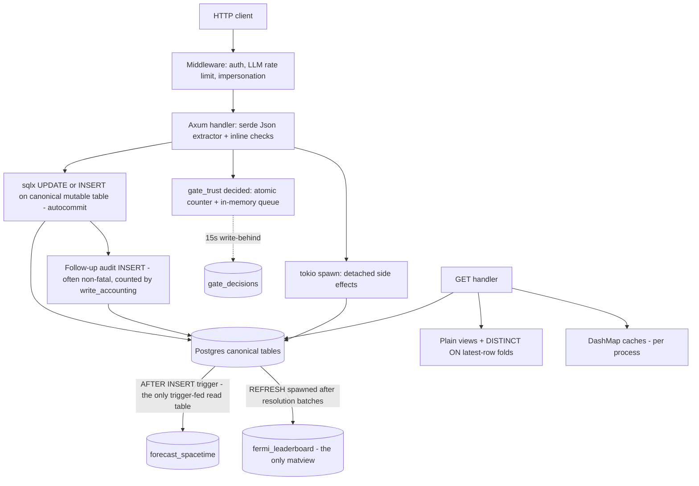

### 4.4 Append-only and immutability: what actually enforces it

| Table | Mechanism | Blocks UPDATE | Blocks DELETE | Notes |
|---|---|---|---|---|
| `episode_corrections` | `BEFORE UPDATE` trigger (`migrations/103:162-172`) | ✅ | ❌ | FK `ON DELETE CASCADE` from `episodes` can erase rows |
| `hitl_actions` | `BEFORE UPDATE` trigger (`106:63-73`) | ✅ | ❌ | Cascades from `anomaly_events` |
| `embedding_provenance` | `REVOKE UPDATE, DELETE … FROM PUBLIC` (`135:106`), the only `REVOKE` in the repo | ⚠ probably no-op | ⚠ probably no-op | The app role runs the migrations, so it is very likely the table owner; PUBLIC revokes do not bind the owner [I] |
| `fermi_forecasts` (scoring fields) | `BEFORE UPDATE` freeze trigger (`174:115-165`) | **Silently reverts** with `RAISE WARNING` | ❌ | The caller sees success |
| `assertion_verifications` | Comment only (`205`) | ❌ | ❌ | Cascades from `episodes` |
| `gate_decisions`, `gate_decision_reviews` | None / comment | ❌ | ❌ | Reviews cascade from decisions |
| `forecast_agent_claims` | Comment ("no UPDATE path") | ❌ | ❌ | |
| `carbon_emission_factors` | Comment | ❌ | ❌ | |
| `credit_ledger` | Comment | ❌ | ❌ | **1 `UPDATE`** at `handlers/billing.rs:334` |
| `workspace_action_log` | Comment ("Immutable after insert") | ❌ | ❌ | **12 `UPDATE`s** |

No triggers were added in migrations 200–243 [V].

The enforced pattern:

```sql
-- migrations/106_hitl_actions.sql:63-73
CREATE OR REPLACE FUNCTION public.hitl_actions_immutable() RETURNS TRIGGER AS $$
BEGIN
    RAISE EXCEPTION 'hitl_actions is append-only; row % cannot be modified', OLD.action_id;
END; $$ LANGUAGE plpgsql;
CREATE TRIGGER trg_hitl_actions_no_update
    BEFORE UPDATE ON public.hitl_actions FOR EACH ROW EXECUTE FUNCTION public.hitl_actions_immutable();
-- no BEFORE DELETE, no TRUNCATE guard
```

The silent-revert pattern, which a C++ reader should treat as an assertion that logs and continues:

```sql
-- migrations/174:121-127
IF NEW.brier_score IS DISTINCT FROM OLD.brier_score THEN
    RAISE WARNING 'fermi_forecasts %: brier_score is immutable once resolved ...';
    NEW.brier_score := OLD.brier_score;   -- the UPDATE "succeeds"
END IF;
```

### 4.5 The CQRS-shaped islands

These are the only places where state is a function of a log rather than a stored value.

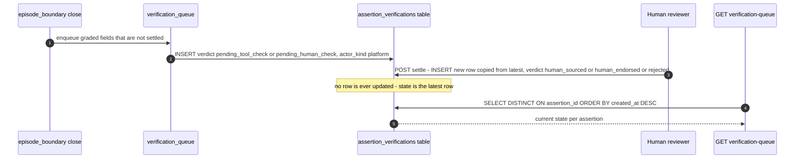

The fold, as written (`handlers/loops.rs:1364-1369`, simplified):

```sql
SELECT DISTINCT ON (assertion_id) assertion_id, verdict, actor, actor_kind, evidence, created_at
FROM assertion_verifications
ORDER BY assertion_id, created_at DESC;
```

`gate_decision_reviews` uses the same shape (`src/gate_review.rs:111-122`).

**What keeps these from being event sourcing:**

1. No database enforcement of append-only.
2. `ON DELETE CASCADE` foreign keys can erase history.
3. They are not written in the same transaction as the effect they describe.
4. `created_at` is a wall-clock timestamp, not a sequence. Two rows with equal timestamps fold nondeterministically [I].

### 4.6 The one attempt at event sourcing: SimOps events

`crates/simops/src/event_kinds.rs` declares `SimOpsEventKind` (17 variants). Its payload schemas exist **only in doc comments**. The persistence path contradicts the declaration [V]:

- The declared storage column `workspace_messages.kind` does not exist in any migration.
- The declared `message_type: "event_append"` is overwritten to `"chat"` or `"agent_invocation"` by `handlers/workspace/messages.rs:276-280`.
- The fold logic (`simops-folds.js`) lives in **another repository** and rebuilds browser state on page mount, not server state.

### 4.7 Concurrency control inventory

| Mechanism | Sites |
|---|---|
| Pessimistic `SELECT … FOR UPDATE` | 3: `resolve_forecast` plpgsql (`api_server.rs:1962`), `relationships/apply.rs:43`, `relationships/undo.rs:41` |
| Guarded single-row update (implicit compare-and-swap) | `wallets … WHERE balance >= $1 RETURNING` |
| Lease table | `consolidation_locks`. `acquire` is one atomic upsert that steals the lease if `expires_at < NOW()` (`memory/src/locking.rs:21-48`). The TTL is 30 min, and `extend` has **no production caller**, so a long consolidation cycle can be stolen mid-run. `cleanup_expired()` returns `Ok(0) // Placeholder` |
| Optimistic versions, ETag, If-Match | **None** |
| Sequence-per-aggregate | **None.** `forecast_spacetime.revision_seq = MAX+1` inside a trigger is the nearest analogue, and it is racy [I] |

### 4.8 The command boundary: there isn't one

- **Cross-cutting middleware** only does auth, rate limiting and the impersonation guard (`api_server.rs:3640-3652`, `5644-5660`). `llm_rate_limit_middleware` is now layered in (`:5646`); the August audit had found it orphaned.
- **Input validation** is serde `Json<T>` deserialisation (about 153 extractors) plus inline checks. There is no `validator`, `garde` or `jsonschema` crate.
- **`schema_validate.rs`** is an in-house JSON-Schema-subset validator. It is applied to agent **outputs** after execution, and its result is *recorded*, not used to refuse (`execution.rs:474-497`).
- **`port_trust::bind_input`** is the only input-side check on execute. It is advisory: making it a control would refuse 47 of 102 cards (`command_registry.rs:266-282`).

### 4.9 Schema lifecycle

- **Ledger.** `run_migrations` (`api_server.rs:565`) iterates about 246 hard-coded migration paths. Each attempt is recorded in `schema_migrations` (migration 207; `ensure_migration_ledger` `:1567`, `record_migration_attempt` `:1591`), including attempts, consecutive failures, first success and content SHA-256 [V].
- **Still lenient.**
  - A failing migration is logged and boot continues.
  - Every file is re-executed on every boot; there is no skip on `first_succeeded_at`.
  - `ensure_critical_schema` (`:1630`) is a second, inline DDL path.
  - `schema_trust` aborts boot only if `SCHEMA_STRICT=1`, and it is warn-only by default (`:2381-2394`).
- **Atomicity under the pooler.** Migrations are wrapped in `DO $$ … $$` blocks to make them atomic.

---

## 5. Provenance

### 5.1 Four axes, no unifying model

| Axis | Question answered | Storage | Vocabulary | Enforced by |
|---|---|---|---|---|
| **Embedding provenance** (Spec 22) | Which model and which text produced this vector? | `embedding_provenance` sidecar plus 6 columns on each of 5 tables | `trusted BOOLEAN`, `model_id`, `model_version`, `dim` | Transaction with the parent row; CHECKs (some conditional) |
| **Episode authority** | Who vouched for this run as memory? | `episodes.provenance`, `authority_weight` | `auto_pass`, `auto_fail`, `human_approved`, … | CHECK. **Hard-coded `AutoPass` / weight 0.5** in the single constructor (`src/episodes.rs:353-354`) |
| **Grounding provenance** | Could this field's value have come from a tool? | `<block>_provenance` keys **inside the output JSON**; `semantic_rules.provenance_floor`; `assertion_verifications.verdict` | `PROVENANCE_VALUES` (10 tokens, strength 0–2) | CHECK on token set; Rust `enforce` |
| **Artifact identity** | Which exact bytes is this? | **Not stored.** Computed on read | `sha256:<hex>` | — |

### 5.2 Embedding provenance (the best-built piece)

```sql
-- migrations/135_embedding_provenance.sql:70-91
CREATE TABLE embedding_provenance (
  provenance_id UUID PRIMARY KEY DEFAULT gen_random_uuid(),
  target_table  TEXT NOT NULL CHECK (target_table IN
                ('episodes','semantic_rules','entities','communities','shopping_profiles')),
  target_id     UUID NOT NULL,                 -- polymorphic: no FK possible
  agent_id UUID, user_id TEXT,
  source_text TEXT, source_ref JSONB,
  model_id TEXT NOT NULL, model_version TEXT NOT NULL, dim INTEGER NOT NULL,
  embedding vector(1024), trusted BOOLEAN NOT NULL DEFAULT TRUE,
  created_at TIMESTAMPTZ NOT NULL DEFAULT NOW(), notes TEXT);
REVOKE UPDATE, DELETE ON embedding_provenance FROM PUBLIC;   -- see 4.4 caveat
```

```rust
// agent-bestiary/memory/src/embeddings.rs:58
pub struct ProvenancedEmbedding { pub vector: Vec<f32>, pub source_text: String,
    pub model_id: String, pub model_version: String, pub dim: i32 }
```

- **Transactional write.** Episodes, rules, entities, communities and shopping profiles each `begin()`, upsert the parent, `insert_provenance_row(&mut tx, …)`, and `commit()` (e.g. `store.rs:306-458`) [V].
- **Defects** [V]:
  - The export handler writes an audit row outside any transaction with `let _ =`, and binds `agent_id` as `target_id` while `target_table='episodes'` (`handlers/agents.rs:1993-2015`).
  - The deprecated batch rule insert skips the sidecar.
  - Centroid `source_text` is `''` instead of NULL.
  - The backfill (migration 145) marks legacy rows `trusted=TRUE`.
  - Migration 136 (the hard NOT NULL step) is not registered with the runner, and 184 applies its CHECK only if no existing row violates it.

### 5.3 Artifact hashing (`src/artifact_hash.rs`)

| Function | Exact hash input |
|---|---|
| `of_text(s)` (`:85-89`) | `"sha256:" ‖ hex(SHA-256(utf8(s)))`. Raw bytes, no normalisation |
| `of_document(v)` (`:109-111`) | `of_text(canonical(v).to_string())` |
| `canonical(v)` (`:118-133`) | Object keys sorted recursively in byte order; **arrays keep their order**; serialised compact by `serde_json` |

```rust
pub struct Hashes {
    pub algorithm: &'static str,                     // "sha256"
    pub input: Option<String>,                       // over episodes.query
    pub output: Option<String>,                      // over response_text, verbatim
    pub output_grounded: Option<String>,             // over the enforced document
    pub enforcement_changed_the_bytes: Option<bool>,
}
```

**Interop warning for a C++ reimplementation.** This is **not RFC 8785 (JCS)**. To reproduce the bytes you must match `serde_json`'s compact output exactly:

- its float formatting (ryu shortest round-trip),
- its string escaping (non-ASCII emitted raw, only control characters and `"` and `\` escaped),
- byte-wise key ordering, with no Unicode normalisation.

**Interaction with `preserve_order`.** The root `Cargo.toml:51-61` enables `serde_json/preserve_order`, so that *display* keeps the order the agent wrote keys in. Identity therefore depends on the explicit sort in `canonical()`: "display preserves order, identity ignores it" (`:70-73`). A test comment at `:225-241` still says the BTreeMap provides the ordering. That comment is stale.

**These hashes are not persisted.** They are computed in the trace handler (`handlers/loops.rs:1231-1235`). The one persisted use is `rule_retrievals.query_sha`. Other hashes in the system use **bare hex** (`declared_prompt_sha256`, `ground_runs.token_hash`). The formats are inconsistent.

### 5.4 Grounding: provenance attached to fields

**Vocabulary and strength** (`src/grounding_trust.rs:65-147`, `:1375-1395`) [V]:

| Strength | Tokens |
|---|---|
| 2 | `tool_verified`, `platform_derived`, `human_sourced` |
| 1 | `model_inference`, `human_endorsed` |
| 0 | `tool_no_match`, `unavailable_no_tool_source`, `pending_tool_check`, `pending_human_check`, `rejected`, and *anything unrecognised* |

- `floor()` (`:1424-1441`) returns the weakest verdict that occurred.
- `extracted_floor()` returns `min(floor, EXTRACTION_CEILING = model_inference)`. Knowledge extracted by an LLM never inherits retrieval strength.

**Contract types:**

```rust
pub enum Grounding {                                    // :1683-1727
    Sourced { tool: &'static str, response_field: &'static str },
    Unsourced,
    Inferred { from: &'static str },
    Derived  { from: &'static str, how: &'static str },
    Narrative,
}
pub struct FieldContract { agent_id, path, grounding: Grounding, why }          // :1731
pub struct Violation { path: String, removed: Value, kind: ViolationKind }      // :4165
pub enum ViolationKind { UngroundedField, NarrativeLeak, ContradictsCanonical } // :4177
pub struct Report { violations: Vec<Violation>, provenance: Vec<(String, &'static str)> } // :4220
```

Contracts come from two places: the static `FIELD_CONTRACTS` table (`:1963-4159`) and a card's compiled `output_contract.grounding`.

**`enforce(agent_id, &mut doc) -> Report`** (`:5309-5514`) mutates the document in place:

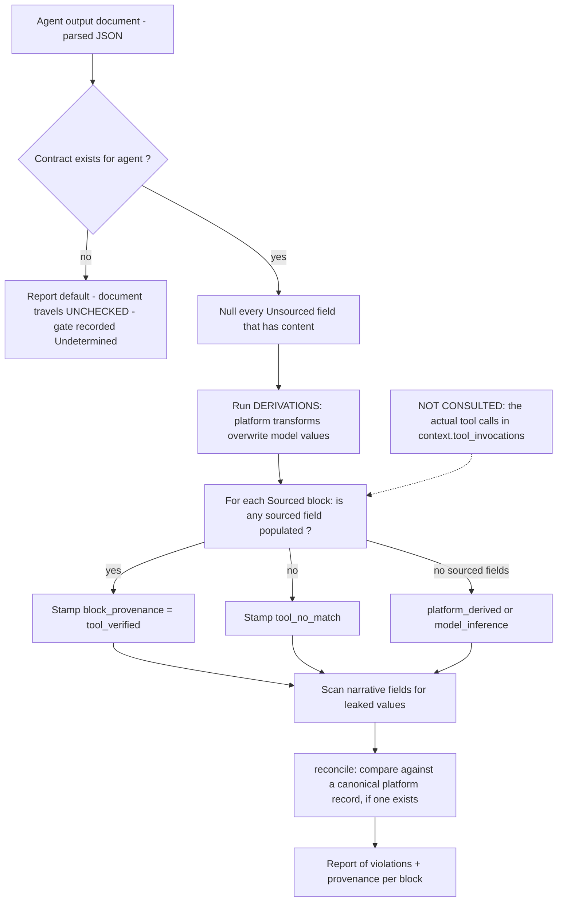

> **Key finding [V].** `tool_verified` is a **content proxy**: "Has sourced fields, and at least one came back populated" (`grounding_trust.rs:5494`). The grader receives the document, never the tool-call log. A model that fabricates a value into a `Sourced` field is stamped `tool_verified`.
>
> Only `reconcile()` catches this, and only where a canonical platform record exists. Its only caller is `genome_profiler`. Even the Grounding Service, which records every tool call verbatim in `ground_run_tool_calls`, passes only the raw text to `grade` (`handlers/ground.rs:532`). The recorded calls feed *completeness* (was the tool called when a field is empty), not *grounding*.
>
> The data needed for a real join is already persisted: `episodes.context.tool_invocations` holds every tool input and output verbatim (`src/episodes.rs:295-301`).

### 5.5 Provenance floor across derived knowledge

When consolidation extracts a `semantic_rule` from a cluster of episodes, `DbProvenanceOracle` (`src/provenance_oracle.rs:155-251`, implementing the `ProvenanceOracle` trait declared in `agent-bestiary/memory/src/provenance.rs` to break a crate cycle):

1. Re-reads each source episode's `response_text`.
2. Re-computes `response_floor` for each.
3. Folds the results through `FloorAccumulator`; an unknown source makes the result unknown.
4. Caps the result at `model_inference`.
5. Writes `semantic_rules.provenance_floor` and `provenance_floor_basis`.

This is the closest the system comes to propagating provenance along a derivation edge. It is **recomputed on every call**; nothing is cached on episodes.

### 5.6 Data-lineage graph

Solid edges are foreign keys. Dotted edges are unenforced pointers.

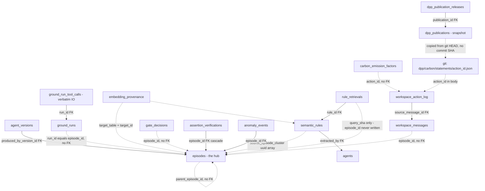

**What a walk can and cannot do:**

- The only recursive walk possible is over `parent_episode_id`, and the one implemented use is cost attribution (the `forecast_cost_attribution` CTE).
- **There is no edge from a carbon factor, an action log row or a DPP publication back to the producing episode.** The dispatch function returns only a `String`.
- **There is no edge from any value to an external source identifier.** There is no DOI resolution, URL replay or dataset registry.

### 5.7 Flagship use: carbon accounting → Digital Product Passport

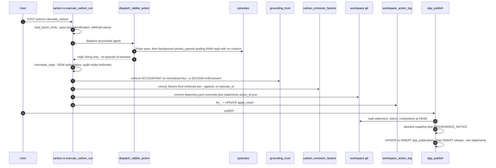

**Strengths:**

- The platform, not the model, owns the arithmetic (`DERIVATIONS`).
- Factor hints pass earlier runs' identification and withhold the value, so readings stay independent.
- A two-publisher cross-check fires on disagreement beyond a 2% transcription band (`grounding_trust.rs:1104-1120`).

**Gaps:**

- The publication is not transactional.
- The snapshot carries no content hash, no source commit SHA, and no signature.
- The publication token is stored in plaintext.
- The gate ledger records the verdict on the raw reply, not on the enforced document that was published [I].

### 5.8 What is absent

- **ΞPROV.** The string appears only in documents. There is no code, table, typed edge or chain walk [V].
- **Interpretive vs evidentiary.** No `JudgeReport` type and no "interpretive" marker exist. Only accidental protection applies: the CHECK on `PROVENANCE_VALUES` contains no judge token, so a judge output cannot be written as a grounding verdict [V/I].

---

## 6. Verification

### 6.1 Two vocabularies: the spec's lattice and the code's ladder

The Lattice spec (`docs/architecture/ABW Verification Lattice — Specification v0.1.md`, untracked, 2026-09-30) defines five independent dimensions per **claim**, with verdict states `pass | fail | unsupported | not_evaluated`, a mandatory interpretive judge report, and policy routing (Proceed, Sign-off, Correct, Endorse, Park). The code implements an older **ladder** (`src/ladder.rs:66-112`) whose rungs have the same names but ask questions about the **platform**:

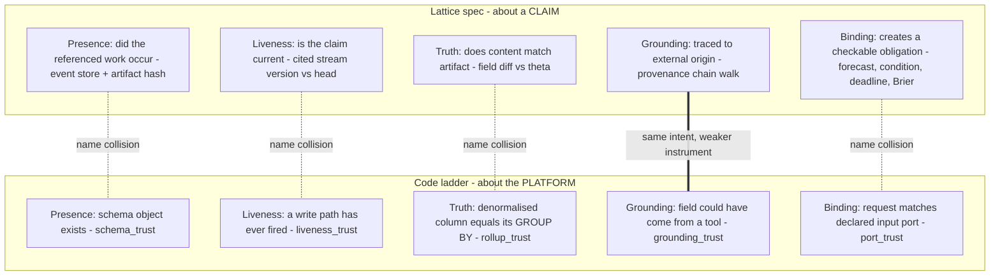

**Treat the ladder as unrelated to the lattice.** Only Grounding overlaps in meaning.

### 6.2 The trust-contract family

Each module is a `const` declaration table, plus pure classifiers, plus a runner. **There is no shared trait** [V]. They are unified one level up by `native_evaluators::Observation`, a snapshot that eight `NativeEvaluator`s score (`src/native_evaluators.rs:107-139, 383-389, 825-836`).

| Module | Verifies | Runs | Verdict goes to | Blocks? |
|---|---|---|---|---|
| `schema_trust` | Declared tables, views, matviews, columns and functions exist in `pg_catalog` | Boot; `GET /api/admin/schema-health` | `eprintln!` + `BootDecision` | Only with `SCHEMA_STRICT=1` |
| `gate_trust` | Counts every gate decision. Flags `never_asked`, `refuses_everything`, `admits_everything` | Every request (atomics); recorder every 15 s | Memory; `gate_decisions` for Recorded gates; `/api/gates` | No (it observes gates) |
| `grounding_trust` | Field contracts per agent (§5.4) | Every invocation via `Pulse::grade`, delegation envelopes, creature handlers | Amends the document; `gate_decisions`; `assertion_verifications` | **Amends**, never refuses |
| `liveness_trust` | Each declared write sink has written; `Silent` if it had opportunities but zero writes | Hourly sweep | In-memory `LATEST`; `/api/admin/liveness` | No |
| `rollup_trust` | Denormalised column equals its source | **CI and pre-commit only** | Test result | CI |
| `port_trust` | Free-text query binds to a declared text `accepts` port | Every execute | `Gate::InputBinding` (Counted) + episode tag | **No.** Records "Refused" while refusing nothing |
| `route_trust` | Server-stamped route reason | Every request | Episode tag | No |
| `outcome_trust` | Does a loop's output discriminate between, and reach, its subjects | Pure, composed into `/api/loops` | View payload | No |

### 6.3 The gate model

```rust
// src/gate_trust.rs:76-130, 392-396
pub enum Clock     { Admission, Invocation, Standing }
pub enum Retention { Counted, Recorded }
#[repr(usize)]
pub enum Gate { Coherence=0, Grounding=1, InputBinding=2, Admission=3, Credit=4,
                RateLimit=5, Attachment=6, OutputSchema=7, InputSchema=8, Completeness=9 }
pub enum Decision { Approved, Refused, Undetermined }   // Undetermined is never a pass

// src/command_registry.rs:68-110: the honest classification of what a gate does
pub enum Enforcement { Control, Metric, Amend, Report, Declared }
```

| Gate | Retention | Enforcement | Physical effect |
|---|---|---|---|
| Credit, RateLimit, Attachment | Counted | **Control** | Refuse before the effect happens |
| Coherence | Recorded | **Control** | Blocks HITL interventions and consensus |
| Admission | Recorded | Control (with `force` bypass audited separately) | Publish pipeline |
| Grounding | Recorded | **Amend** | Nulls fields; cannot refuse because the output already exists |
| OutputSchema | Recorded | Report | Status in the response |
| Completeness | Counted | Report | Status. **Not in the migration-230 CHECK**, so promoting it to Recorded without a migration would poison the ledger flush |
| InputSchema | Counted | Metric | Computed and dropped |
| InputBinding | Counted | Metric (advisory) | Records `Refused`, changes no control flow |

### 6.4 The gate ledger: write-behind mechanics

`decided_full` (`src/gate_trust.rs:543-583`) is called synchronously from handlers. It does no I/O: a relaxed atomic increment, then a `Vec` push under a `std::sync::Mutex`.

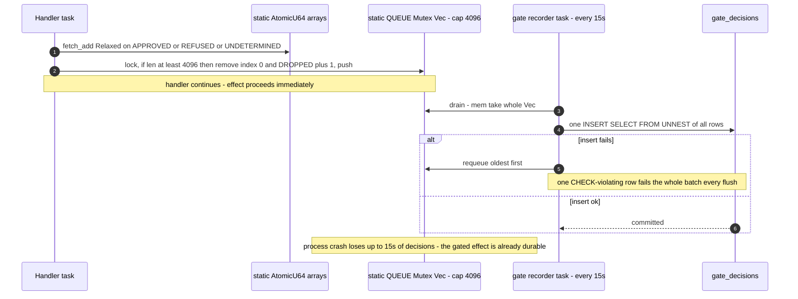

**What this means physically:**

- **Not atomic with the gated effect.** A durable effect can have no durable decision, and vice versa. Both are possible within the 15 s window.
- **`q.remove(0)` is O(n) on a 4096-element `Vec`.** It only matters when the recorder is already behind [V/I].
- **A poison row stalls the ledger.** A batch with one invalid row is requeued whole, so every later flush fails until drop-oldest evicts it, and the decisions queued behind it are lost with it [I; the code acknowledges this at `:431-437`].
- **No gamma or diagnosis is stored.** `gate_decisions` keeps `reason` (≤ 400 chars, non-approvals only), `subject` (≤ 200 chars), and `episode_id`.

### 6.5 The coherence gate

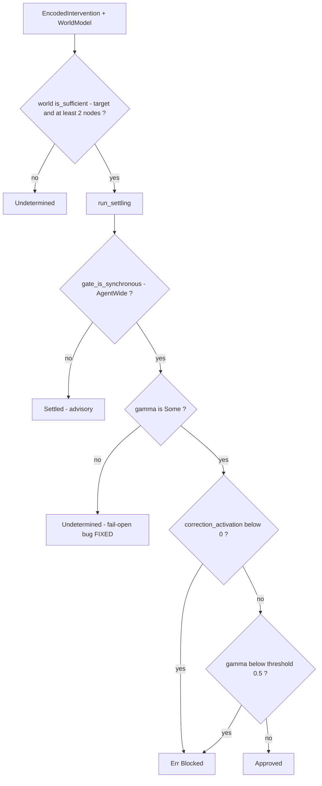

Source: `agent-bestiary/coherence-gate/src/gate.rs:199-253` [V]. The `if let Some(gamma)` fail-open reported in August is fixed.

Remaining hazards:

- **The consensus step re-runs the gate instead of replaying it.**
  - `confirm_two_reviewer_handler` calls `gate.check(&encoded)`, which is `check_against(_, &WorldModel::default())`. That world model is insufficient, so the result is **always `Undetermined`** (`handlers/observatory.rs:808-817`) [V].
  - That vacuous outcome is serialised into `episode_corrections.coherence_check`.
  - The first reviewer's real Γ and minimum-update set are not stored anywhere (`TwoReviewerRequest` keeps only the encoded intervention).
- **Infrastructure errors read as refusals.** `SettlingFailed` and other `GateError`s are recorded as `Refused` (`observatory.rs:571-576`), which inflates refusal rates.
- **`Undetermined` on AgentWide proceeds on human review alone**, with a warning (`:602-608`). This is fail-to-human by design.

### 6.6 Claims: assertions and the verification queue

```rust
// src/assertions.rs (abridged)
pub enum AssertionKind { Multiplier, Fact, Quantity, Probability }   // only Quantity and Fact are verifiable
pub enum ExtractionPath { TypedField { schema: String, field_path: String }, Prose { pattern: String } }
pub enum Claim { Numeric(Spread), Literal(serde_json::Value) }       // Spread { p5, p50, p95 }
pub struct Assertion { assertion_id: Uuid, kind, value: Claim, basis: Vec<String>,
                       extraction: ExtractionPath, target_hint: Option<String>, raw: Option<String> }
pub enum Route { None, Automated, Human, InheritFromBasis }
```

- **Entitled provenance** is `min(floor(basis), kind.ceiling(), extraction.ceiling())`. Prose extraction is capped at `model_inference`.
- **`Assertion::route`** (`:423-435`) is the only router in the system:

  | Condition | Route |
  |---|---|
  | Kind not verifiable | `InheritFromBasis` |
  | Entitled strength ≥ 2 | `None` (already settled) |
  | A tool is named | `Automated` |
  | Otherwise | `Human` |

- **`Automated` has no consumer** [I: no worker found by grep]. `pending_tool_check` rows wait for a human.
- **Because `tool_verified` is a content proxy (§5.4), filled sourced fields reach strength 2 and route to `None`.** They are never queued [I]. The verification queue therefore mostly sees *empty* or *inferred* fields, and the fields most likely to be fabricated are never queued.

### 6.7 Evaluators and the LLM judge

```rust
// agent-bestiary/evaluators/src/model.rs:20-43
#[async_trait] pub trait EvalModel: Send + Sync {
    fn name(&self) -> &'static str;  fn version(&self) -> &'static str;
    fn tier(&self) -> EvalTier;      // PreFilter (serial, may short-circuit) | Dimensional (parallel)
    fn dimensions(&self) -> Vec<Dimension>;
    async fn evaluate(&self, bundle: &EpisodeBundle) -> Result<EvalResult, EvalError>;
}
```

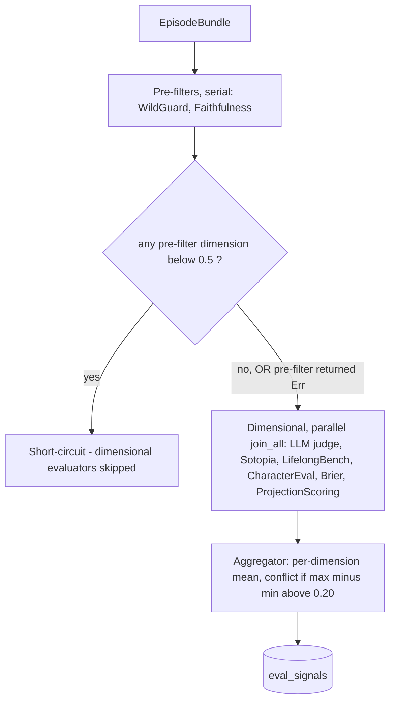

- **Pre-filter errors fail open** [V]. `Err` maps to "not below block" (`registry.rs:124-130`, `_ => false`), so a provider outage on the safety filter lets everything through to scoring.
- **The judge is not independent** [V]. Its default model `claude-haiku-4-5-20251001` (`handlers/eval_judge.rs:37`) is the same string as the default agent model (`agent_card.rs:830`).
- **The judge can be steered by the output it grades** [V]. The agent output is interpolated directly into the judge prompt (`AGENT OUTPUT:\n{}`, `eval_judge.rs:93-104`).
- **No interpretive type.** Judge scores are ordinary `EvalResult` dimensions, averaged with the deterministic evaluators.

### 6.8 Lattice dimension mapping

| Dimension | Spec instrument | Closest real code | Status |
|---|---|---|---|
| Presence | Event store + artifact hash lookup | None. Hashes are computed on read and never indexed | **Absent** |
| Liveness | Cited stream version vs head | None. No stream versions exist | **Absent** |
| Truth | Field diff vs artifact, scored against θ | `grounding_trust::reconcile` (one agent, binary, overwrites); offline `CROSS_CHECKS` SQL | **Partial** |
| Grounding | Provenance chain walk to an external origin | `enforce` + floor + `verification_queue` + human settlement | **Partial**: categorical, contract-based, content-proxy |
| Binding | Forecast + outcome condition + deadline, Brier at outcome | `forecast_commitments.commitment_hash`, `projection_commit`, `ClaimBinding`/`classify_claim`, `calibration::brier_skill` | **Partial**: no per-claim deadline; per-agent Brier is a copy of the forecast's Brier |
| Verdict vector | One object per claim | None. Closest is `/api/episodes/:id/trace` (a read-time assembler) | **Absent** |
| `unsupported` state | Truth passes, Grounding fails | None | **Absent** |
| Judge report | Mandatory, interpretive | Eval-run-only Likert scores | **Absent** |
| Routing (5 actions) | Tenant policy | `assertions::Route` (verification only) | **Absent** |
| Correction budget | Per claim | None | **Absent** |
| Events (`claim.submitted`, …) | Event schema | None | **Absent** |
| Residual risk | Per-dimension false-pass rate | None. `gate_decision_reviews` is the only false-pass signal, and it has 0 rows per the code comment | **Absent** |

### 6.9 Loops

| Loop | Closed automatically? | Evidence |
|---|---|---|
| Loop 1: episodes → rules (consolidation) | Automatic code path, **sweeper off by default** | `handlers/consolidation.rs:770-783` |
| Loop 2: human correction | Gate is automatic; the decision is human | `loop_api.rs:74-95` |
| Loop 3: workspace coherence | Partly; stages are prompted or paid | `loop_model.rs:286-375` |
| Loop 4: composition evolution | **Not built** at the `proposed` stage | `loop_model.rs:427-435` |
| Loop 5: Brier / projection | Measurement only | `loop_model.rs:452-560` |
| Spec "outer loop" (θ and policy adjustment) | **Absent**: every θ is a `const` | coherence 0.5 (`gate.rs:66`), pre-filter 0.5 (`registry.rs:78`), conflict 0.20 (`aggregator.rs:15`), `UNIVERSAL_SHARE` 0.10, `CORROBORATION_BAND` 0.30 |

The **only measurement consumed by a decision** is `select_agent` (`tools/domains/workspace.rs:488-588`). It ranks candidates by Brier (weight 0.40), cost (0.20), valence fit (0.20) and output-schema gate fidelity (0.20). Most fidelity rows are `Undetermined`, because 98 of 101 curated cards declare no schema, so the term falls back to a 0.5 prior [I: figures from code comments].

---

## 7. How CQRS, provenance and verification interact

This section composes §3 to §6 into one picture: what happens to **one claim**, and what can be proven about it afterwards.

### 7.1 One claim, end to end

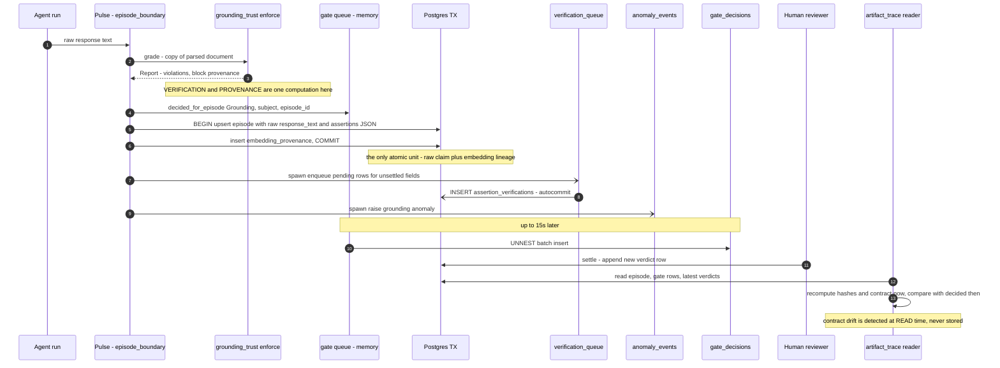

**Three design choices show up in this sequence:**

1. **Verification produces provenance.** `grounding_trust::enforce` is both the verifier (it nulls and amends fields) and the provenance stamper (it writes the `<block>_provenance` keys). There is no separation between "evidence" and "verdict". The spec's principle 1, "evidence, not verdict", is inverted.
2. **The raw claim is kept and the response is amended.** `episodes.response_text` stores the model's raw output on purpose, so evidence of fabrication is preserved. The HTTP response carries the amended document (`execution.rs:523-527`). The A2A poll path **re-runs enforcement on read** (`a2a.rs:608-623`), so a later contract change alters what a poller sees for an old episode [V].
3. **The audit trail is assembled at read time.** `artifact_trace.rs` joins static registries (`command_registry`, `gate_trust::GATES`, grounding contracts) with stored rows. It keeps "decided then" (`Decided`) separate from "recomputed now" (`Recomputed`). This is the system's replacement for event replay: it **re-derives** rather than **replays**.

### 7.2 Consistency boundaries

Physically, there are five durability classes on the execute path:

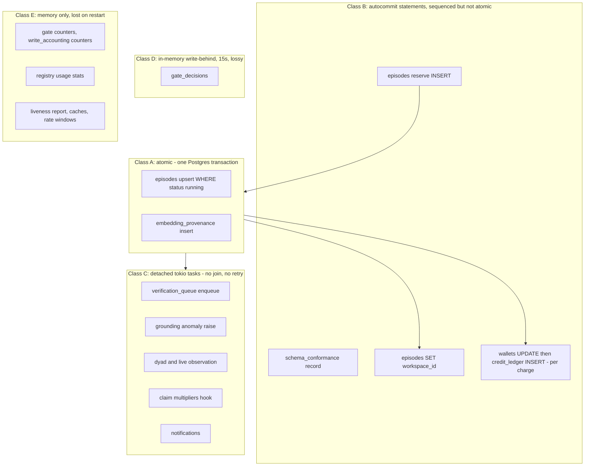

### 7.3 Crash-point analysis

Assume `SIGKILL` at each point. This is what persists.

| Crash after… | `episodes` | Provenance | Verification records | Money | Net invariant violated |
|---|---|---|---|---|---|
| `Pulse::open` | `running` row | — | — | Not charged | Orphan `running` row, which panics readers (§3.3) |
| Executor loop (mid-LLM) | `running` row | — | — | Not charged | Same, plus LLM spend lost |
| Grounding grade, before `close` | `running` row | — | Gate decision in memory only | Not charged | Decision lost |
| `close` commit | Terminal row | Sidecar row | Gate decision possibly still queued; queue rows possibly missing | **Not charged** | Free execution; missing verification rows |
| Wallet `UPDATE`, before ledger `INSERT` | Terminal | ✓ | Partial | Debited | **Debit with no ledger row** |
| Response sent, before 15 s flush | Terminal | ✓ | Queue rows ✓ (if the task ran) | Charged | Gate decision lost; `gate_decisions` under-counts |

### 7.4 What can be proven about an episode afterwards

| Question | Answerable? | Source | Strength |
|---|---|---|---|
| Which agent? | Yes | `episodes.agent_id` FK | Strong |
| Which configuration ran? | **Partly** | `produced_by_version_id` (DB columns at write time) + `context.card_prompt_hash` | Weak: the effective merged card is never stored (§2.3) |
| What was asked and said? | Yes | `query`, `response_text` (raw) | Strong, but mutable rows |
| Which tools were called, with what I/O? | Yes | `context.tool_invocations` (verbatim) | Strong, but **unused by grounding** |
| Which model produced the embedding? | Yes | `embedding_provenance` | Strongest in the system |
| What did the grounding gate decide? | **Probably** | `gate_decisions.episode_id` | Lossy write-behind, no FK |
| Which fields are pending or settled? | Yes | `assertion_verifications`, latest row | Good, append-only by convention |
| Was the caller charged for it? | **Not reliably** | `credit_ledger.related_id` [I: linkage not traced] | Weak |
| Did a downstream artifact (carbon factor, DPP) come from it? | **No** | No column exists | — |
| Were the bytes altered since? | **No** | No stored hash; the row is mutable | — |

### 7.5 Spec-intended vs actual interaction

```mermaid
flowchart TD
    subgraph Intended["Lattice spec - intended"]
        I1["Command boundary - schema prefilter"] --> I2["Event store: claim.submitted"]
        I2 --> I3["Lattice: 5 independent dimensions"]
        I2 --> I4["Judge report - interpretive"]
        I3 --> I5["lattice.evaluated - verdict vector"]
        I4 --> I6["Routing policy per tenant"]
        I5 --> I6
        I6 --> I7["Proceed, Sign-off, Correct, Endorse, Park"]
        I7 --> I8["Outcome observed - calibration updated - theta adjusted"]
        I2 -. "PROV chain" .-> I3
    end
    subgraph Actual["Code - actual"]
        A1["Per-handler serde + inline checks"] --> A2["Mutable episodes row"]
        A2 --> A3["grounding enforce - amend + stamp, one rung"]
        A3 --> A4["gate_decisions via write-behind"]
        A3 --> A5["assertion_verifications pending rows"]
        A5 --> A6["Human settle - append"]
        A2 --> A7["artifact_trace - re-derive at read time"]
        A4 --> A7
        A6 --> A7
        A7 --> A8["No routing, no budget, constant theta"]
    end
```

---

## 8. Extension surfaces

```mermaid
mindmap
  root((ABW extension surfaces))
    Runtime declarative
      App manifests JSON
      Agent cards and DB overrides
      Remote MCP servers per agent
      Workspace templates
    Network protocols
      REST JSON API unversioned
      A2A v1.0 HTTP plus JSON
      MCP per-agent JSON-RPC over HTTP
      MCP stdio server for editors
      Stripe webhook
    Compile-time plugins
      PlatformTool trait
      Skill registry
      EvalModel trait
      Feed and Extractor traits
    Clients
      abw CLI
      fermi-console GPUI
      Zed extension and fermi-lsp
      Flutter rabble-web bundle
      Smart-glasses shells
```

### 8.1 Apps

An **App** bundles a schema, a composition, a workspace template, UI and economics. A workspace is a `teams` row linked to its App only by `teams.origin = app.slug`, with no foreign key (`handlers/apps.rs:538-545`) [V].

**Manifest validation** is a pure crate (`crates/abw-apps-core`, depends only on serde), shared by the CLI, the server, Xaman Ek and the fork flow:

```rust
pub struct PartialManifest { slug, name, tagline, description, homepage_url, icon_url,
    composition_slug, schema_slug, schema_json: Option<Value>, workspace_template: Option<Value>,
    visibility, metadata: Option<Value> }                              // lib.rs:137-151
pub enum Severity { Error, Warning, Info, Suggestion }                 // :52
pub struct Issue { severity, field: String, message: String, fix: Option<Fix> }
pub struct Fix   { label: String, patch: Value /* RFC 6902 JSON Patch */ }
pub fn build_manifest(input: PartialManifest) -> BuildResult           // :465
```

- Slugs must match `^[a-z][a-z0-9_]{2,63}$`, and some slugs are reserved.
- `workspace_template` is untyped JSON, checked structurally: `{initial_budget, auto_hire[], initial_files[{path, content}], default_name_pattern}`.
- There is **no manifest format version field**.

**Spawn** (`POST /api/apps/:slug/workspaces`, `apps.rs:448-698`):

```mermaid
sequenceDiagram
    autonumber
    participant C as Caller
    participant H as spawn_workspace_handler
    participant T as teams
    participant W as workspace wallet
    participant G as workspace git
    participant O as workspace_outputs and dependencies
    participant A as workspace agents

    C->>H: spawn with extra_budget
    H->>H: visibility check, archived returns 410
    H->>H: total_budget = template initial_budget + max of extra_budget and 0
    H->>T: create_team origin = slug
    H->>W: let _ = credit_deposit total_budget
    Note over C,W: caller is NEVER debited - credits are minted
    H->>G: commit each initial file - one commit per file
    H->>O: write params json, params output row, dependency edges
    H->>A: direct INSERT auto-hire agents - bypasses hire checks
    H-->>C: workspace id
    Note over H: no transaction - each step may fail independently
```

> **P0 defect [V].** `extra_budget` has a floor of 0 and no ceiling (`apps.rs:484`). The budget is deposited (`:560-568`, and again in the batch handler) and **nothing debits the caller**: there is no `charge`, `debit` or `withdraw` anywhere in `handlers/apps.rs`. Anyone who can spawn from a public App can mint arbitrary credits into a workspace wallet they control.
>
> Auto-hire also inserts agents by name with `status IN ('active','published','draft')` and **no ownership check**, so another user's draft agent can be hired.

### 8.2 The `abw` CLI (`crates/abw-cli`)

- **Commands:** `login`, `whoami`, `logout`; `app {new, validate, deploy, spawn, list, publish}`; `workspace {message, files get/put, actions …}`; `admin agents …`.
- **Configuration:**
  - Base URL precedence: `--base-url`, then `$ABW_BASE_URL`, then `https://agent-bestiary.world`.
  - Credentials live in `~/.abw/credentials` (mode 0600). `$ABW_API_TOKEN` overrides the file.
- **Login flow:**
  1. The CLI binds a random port on `127.0.0.1` and opens `/auth/cli?callback=…&state=…`.
  2. The server mints an API key with scope `["cli"]`.
  3. The server redirects to the callback with **`?api_key=<plaintext>` in the query string**.
  4. The state nonce is built from time and pid (`login.rs:368-380`).
- **Deploy** probes with `GET /api/apps/:slug`, then sends `PUT` or `POST`.
- **Documented but not built:** `abw app generate-cli`.

### 8.3 MCP

**ABW as an MCP server: two implementations.**

| | stdio (`src/bin/agent-mcp-server.rs`) | HTTP (`src/handlers/mcp.rs`) |
|---|---|---|
| Transport | `rust-mcp-sdk` `StdioTransport`, protocol `2025-11-25` | Hand-rolled JSON-RPC: `GET/POST /mcp/agents/:agent_id` |
| Tenancy | Single tenant; provider keys from environment | Multi-tenant; auth required to call; discovery is public |
| Surface | 16 tools: agent CRUD, execute, catalogue, Xaman Ek, FPL, 7 BayesOps | `initialize`, `tools/list`, `tools/call`, `execute` |
| Notes | `save_agent` writes to disk and makes a git commit | Published tools run `PlatformToolRegistry::execute` directly, with no LLM, charged at `GAS_GROUND_TOOL_CALL`. Export allowlist is `capabilities.mcp_tools` |

**ABW as an MCP client** (`src/agent_backend/mcp_client.rs`):

```rust
enum McpTransport { #[default] StreamableHttp }    // stdio deliberately rejected; no subprocess ever spawned
struct RemoteMcpServer { name, endpoint: Option<String>, transport, auth: Option<RemoteMcpAuth>,
    tool_allowlist: Vec<String>, protocol_version: Option<String>, timeout_secs: Option<u64>,
    command: Option<String> /* parsed, never spawned */, env: HashMap<String, String> }
```

- `tools/list` is cached for 600 s. Each call has a 30 s timeout. A **new `reqwest::Client` is built per RPC**, so there is no connection reuse.
- Remote tool names are namespaced `server__tool`. **Builtins win** on collision, because remote tools are only tried when no platform tool matches.
- Missing credentials make the call fail closed.
- **There is no SSRF filter.** Endpoints accept any `http(s)` URL, including loopback, RFC 1918 and link-local addresses such as `169.254.169.254` [V by grep].

### 8.4 A2A

| Method | Path | Auth |
|---|---|---|
| GET | `/.well-known/agent-directory.json`, `/a2a/:slug/agent-card.json` | None |
| POST | `/a2a/:slug/:method` (`message:send` or `message:stream`) | Bearer API key with scope `a2a:invoke:*` or `a2a:invoke:<slug>` |
| GET | `/a2a/:slug/tasks/:episode_id` | API key |
| CRUD | `/a2a/:slug/tasks/:id/pushNotificationConfigs[/:config_id]` | API key, filtered by caller |

The `:method` capture exists because matchit 0.7 treats `:` as a parameter marker anywhere in a segment. Registering both colon routes literally panicked at boot (`handlers/a2a.rs:164-205`).

```mermaid
stateDiagram-v2
    [*] --> SUBMITTED: returnImmediately true
    SUBMITTED --> SUBMITTED: agent NEVER runs
    [*] --> WORKING: message stream
    [*] --> COMPLETED: message send success
    [*] --> FAILED: message send failure
    WORKING --> COMPLETED
    WORKING --> FAILED
    CANCELED: CANCELED - defined, never emitted, no cancel endpoint
```

**Hazards** [V]:

- **The task poll has no ownership check.** `get_task_handler` checks only the key's scope, then loads `get_episode(episode_id)` (`a2a.rs:583-656`). It never verifies that the episode belongs to the caller or to `:slug`'s agent. Any key with `a2a:invoke:*` can read any episode whose UUID it knows.
- **The poll re-applies the *current* output contract** to the stored raw text. What a caller sees for an old task changes when the contract changes.
- **Webhooks are unsafe:**
  - `tokio::spawn` fire-and-forget with a 20 s timeout and **no retries**.
  - **No HMAC signature.** The caller's `token` is stored but never sent.
  - `auth_credentials` is stored **in plaintext** (migration 224).
  - **No URL validation (SSRF).**

### 8.5 Compile-time plugin points

```rust
// src/agent_backend/tools/platform_tool.rs:126-187
#[async_trait] pub trait PlatformTool: Send + Sync {
    fn name(&self) -> &'static str;              // the stable contract: cards name tools by this string
    fn description(&self) -> &'static str;
    fn input_schema(&self) -> Value;
    fn category(&self) -> ToolCategory;          // 17 variants
    fn is_llm_visible(&self) -> bool { true }
    fn requires_workspace(&self) -> bool { false }
    fn is_delegation(&self) -> bool { false }
    fn required_credential(&self) -> Option<&'static str> { None }
    fn response_shape(&self) -> Option<&'static ToolResponse> { None }   // documentation only, not validated
    async fn execute(&self, input: &Value, ctx: &ToolContext) -> Result<String, String>;
}
```

**Recipe: add a tool.**

1. Define a zero-size `struct` and `impl PlatformTool` for it.
2. Push it into its domain's `tools()` vector (`tools/domains/*.rs`). Aggregation happens in `domains::all_tools()` (`domains/mod.rs:54-74`).
3. Recompile.

The tool becomes **visible to every agent**, because there is no per-agent allowlist (§2.5). It runs **in process**, with full `ToolContext` access to the pool, git, the memory store and credentials. There is no sandbox, no per-tool timeout beyond what the tool itself does, and no capability check other than `required_credential` and `requires_workspace`.

`ToolContext` (`tools/context.rs:9-70`): `memory_store, embedder, registry, current_agent_id, workspace_id/slug/git, db, gas_fees, user_id, user_secrets, credentials, parent_episode_id, eval_trigger, remote_mcp`.

**Other plugin points:**

- **Evaluators:** implement `EvalModel` in a crate, add a Cargo dependency, and **edit two registration sites** (`handlers/eval.rs:965-1047`, `handlers/live_observability.rs:160-161`).
- **BayesOps feeds:** implement `trait Feed { name; description; config_schema; describe; fetch }` and register it in `src/feeds/mod.rs:44-53`.

### 8.6 Language tooling

| Component | Notes |
|---|---|
| FPL core | `lexer.rs`, `parser.rs`, `ast.rs`, `executor.rs` (seeded `StdRng` Monte Carlo). Keywords include `question, evidence, agent, model, simulate, factor, param, import, output, learnable` |
| `tree-sitter-fpl` | **Has drifted.** It covers only `forecast/driver/estimate`, and the real lexer has no `forecast` keyword |
| `fermi-lsp` | tower-lsp 0.20 + rowan: completion, hover, code lens, code actions |
| Zed extension (`extensions/fermi` → `examples/fermi`) | Hard-codes the LSP path `/home/ilabra/fermi/fermi-lsp/target/release/fermi-lsp`, so it is not portable. The grammar is pinned to a stale commit |

### 8.7 Authentication and credentials (`fermi-auth`)

| Mechanism | Detail |
|---|---|
| API keys | `ferm_` + 64 hex characters from `OsRng`. Argon2 hash, looked up by the first 12 characters, then verified. **Role-derived scopes are merged into every key**, so an admin's `cli`-scoped key is an admin key |
| Sessions | HS256 JWT in the `abw_session` cookie, valid 7 days. Impersonation tokens last 30 minutes |
| Token source precedence | Bearer header, then impersonation cookie, then session cookie, then `?token=` (for SSE) |
| User secrets | AES-256-GCM with `SECRETS_ENCRYPTION_KEY` |
| Provider credentials | `CredentialSource { AgentScoped, PrincipalDefault, LegacyUserSecrets, Unfunded }` (`agent_backend/credentials.rs:45-58`) |

### 8.8 Contract versioning

There is **no versioning of extension contracts** [V]:

- REST has no `/v1` prefix.
- App manifests have no format version.
- The tool contract is the name string alone.
- Protocol versions are pinned per surface: MCP client `2025-06-18`, stdio server `2025-11-25`, A2A `1.0`.
- Only `EvalModel::version()` carries a version.

---

## 9. Gap register

**Severity scale:**

- **P0**: exploitable or money-losing now.
- **P1**: silent corruption or crash risk.
- **P2**: architectural gap that blocks a stated requirement.
- **P3**: hygiene or drift.

| ID | Sev | Area | Finding | Evidence | Consequence | Direction |
|---|---|---|---|---|---|---|
| G01 | **P0** | Economics / Apps | App spawn deposits `initial_budget + extra_budget` (no ceiling) and never debits the caller | `handlers/apps.rs:484, 560-568`; batch `:1283-1292` | Unbounded credit minting | Charge the caller in the same transaction as the deposit, or treat the budget as an allowance funded at spend time; cap `extra_budget` |
| G02 | **P0** | A2A authz | Task poll loads any episode by UUID with no ownership or slug check | `handlers/a2a.rs:583-656` | Cross-tenant data read | Filter `episodes.user_id = caller` and agent = slug's agent; return 404 otherwise |
| G03 | **P0** | Network | No SSRF guard on remote MCP endpoints or A2A webhook URLs | `mcp_client.rs:209-218`; `a2a_webhook.rs:28-37` | Internal service and metadata-endpoint access | Resolve, then deny private, loopback and link-local ranges; pin the resolved IP for the connection |
| G04 | **P0** | Money path | `charge` is two autocommit statements; the execution fee soft-fails to free; gas is charged after the work | `fermi-auth/src/credits.rs:227-295`; `execution.rs:783-817`; `messages.rs:718` | Debit without ledger; free runs; non-reconcilable books | One transaction per charge; reserve before work, settle after; ledger-derived balance check |
| G05 | P1 | Robustness | `.parse().unwrap()` on `execution_status`, while `running` is not a parseable status | `memory/src/types.rs:363-374`; `store.rs:591-593` | Reader and sweeper panics on orphan rows | Add `Running` to the enum; never `unwrap` DB data |
| G06 | P1 | Robustness | Byte-index slice of a `String` at 32 000 | `tool_executor.rs:331-336` | Panic on multi-byte boundary | Truncate at `floor_char_boundary` |
| G07 | P1 | Lifecycle | Executor `Err` returns before `close`, so `running` rows are orphaned; the only reaper is a rabble path | `execution.rs:312-320`; `messages.rs:520-528` | Dangling rows (feeds G05) | Close with `Failure` on every exit path (RAII-style guard) |
| G08 | P1 | Verification ledger | Gate decisions: write-behind, 15 s, drop-oldest at 4096, poison batch requeued whole | `gate_trust.rs:478-610, 772-853` | Lost or stalled audit; decisions not atomic with effects | Insert in-transaction with the effect, or a durable outbox; per-row fallback on batch failure |
| G09 | P1 | Grounding | `tool_verified` = field populated; tool calls never consulted | `grounding_trust.rs:5494`; `ground.rs:532` | Fabrications certified at strength 2 and never queued | Join sourced values against `context.tool_invocations`; demote unmatched values to `model_inference` |
| G10 | P1 | Coherence | Consensus re-runs the gate with an empty `WorldModel`, so the result is always `Undetermined`, and this is persisted | `observatory.rs:808-817`; `gate.rs:190-192` | Vacuous durable verdicts; first Γ lost | Persist the first `GateOutcome`; replay it rather than re-run |
| G11 | P1 | Evaluators | Pre-filter `Err` treated as pass | `evaluators/src/registry.rs:124-130` | Safety filter fails open on provider outage | `Err` → `Undetermined`, blocking dimensional scoring |
| G12 | P1 | Judge | Same default model as agents; output interpolated into the prompt | `eval_judge.rs:37, 93-104` | Correlated errors; prompt injection | Enforce lineage independence; delimit and escape the graded output; add an `Interpretive` type |
| G13 | P1 | Config | Boot seeder overwrites prompt, model, temperature and `mcp_servers` of curated agents | `store.rs:693-697`; `api_server.rs:5858` | API edits silently revert on deploy | Seed only on insert, or record seeding as a version |
| G14 | P1 | Versions | `agent_versions`: no UNIQUE, no hash, `MAX+1` race, non-atomic, `.ok()` swallow; snapshots DB columns, not the effective card | `store.rs:1192-1213`; `handlers/agents.rs:2401-2416` | Cannot prove which configuration produced an episode | Version the **resolved card**: canonical-JSON hash as identity, UNIQUE, same transaction as the edit |
| G15 | P1 | Immutability | "Append-only" mostly by comment; triggers block UPDATE but not DELETE; cascades erase logs; REVOKE probably ineffective | §4.4 | Audit history is mutable | `BEFORE UPDATE OR DELETE` triggers; `ON DELETE RESTRICT`; separate owner and app roles |
| G16 | P1 | Schema | Migration failures continue boot; all files replay every boot; duplicate inline DDL; `SCHEMA_STRICT` off by default | `api_server.rs:565, 1514-1537, 1630, 2381-2394` | Schema drift between environments | Skip on recorded success plus checksum match; fail boot on failure; delete the duplicate DDL path |
| G17 | P1 | Rate limits | Workspace message and coherence-evaluate paths run the tool loop but are not in `LLM_SPEND_ROUTES` | `api_server.rs:244-263`; `messages.rs:515-521` | Unthrottled LLM spend | Classify by handler, not path allowlist |
| G18 | P2 | CQRS | No streams, sequences or expected-version checks | §4.7 | Lattice Liveness cannot be implemented | §10 |
| G19 | P2 | Provenance | No content-addressed artifact store; hashes not persisted | `artifact_hash.rs` | Lattice Presence cannot be implemented | §10 |
| G20 | P2 | Lineage | Carbon factors, action log and DPP have no `episode_id`; DPP publish is two statements with no hash, source SHA or signature; plaintext token | `carbon.rs`; `dpp_publish.rs:451-499`; mig 243 | Published passports are not traceable or tamper-evident | Return the episode id from dispatch; store the commit SHA and snapshot hash; sign; hash the token |
| G21 | P2 | Scale-out | Rate limits, counters, gate queue, caches, liveness report and git disk are per process | §1.4 | Wrong numbers and data divergence with more than one replica | Move to Postgres or shared storage before scaling |
| G22 | P2 | Hash formats | `sha256:` prefixed vs bare hex; serde_json canonical form is not JCS | §5.3 | Cross-language verification is brittle | Adopt JCS and one multihash-style prefix |
| G23 | P2 | Loops | Every θ is a `const`; no outer loop; gate reviews change nothing | §6.9; `gate_review.rs:28-31` | No self-correction | Store θ as versioned data; feed `gate_decision_reviews` into it |
| G24 | P2 | Tools | Every agent gets every builtin tool, in process, unsandboxed; `mcp_tools` is not an allowlist | `tools/registry.rs:120-162` | Excess privilege for every agent | Per-agent allowlist from the card; capability tokens on `ToolContext` |
| G25 | P2 | A2A | `returnImmediately` never runs; `CANCELED` unused; webhooks have no retries or HMAC; plaintext credentials | §8.4 | Protocol non-conformance | Job table + worker; HMAC signing; encrypt credentials |
| G26 | P2 | Attachments | Images dropped on the tool loop | `tool_executor.rs:210-213` | Silent loss of multimodal input | Pass attachments into loop messages |
| G27 | P3 | Auth | CLI key in redirect query string; guessable nonce; role scopes merged into every key | §8.2, §8.7 | Key leakage via history; over-privileged keys | Code-exchange flow with a CSPRNG state; intersect scopes, don't union |
| G28 | P3 | Consolidation | Lease `extend` never called; `cleanup_expired` placeholder; sweeper off by default but documented as on | `locking.rs`; `consolidation.rs:770-783` | Stolen leases mid-run | Heartbeat-extend the lease |
| G29 | P3 | Data | `semantic_rules.origin`, `rule_retrievals.episode_id` never written; export audit row has wrong `target_id` | §5 | Dead columns, wrong audit | Write them or drop them |
| G30 | P3 | Semantics | `InputBinding` records `Refused` while refusing nothing; coherence infrastructure errors recorded as `Refused` | `execution.rs:644-662`; `observatory.rs:571-576` | Misleading metrics | Record as `Undetermined` with a reason class |
| G31 | P3 | Connections | SSE handler opens a `PgListener` per client, outside the pool | `messages.rs:1205-1208` | Connection exhaustion under load [I] | Use the shared `pg_notify` broadcast |
| G32 | P3 | Tooling | tree-sitter grammar drift; Zed extension hard-coded path; stale `zed-mcp-config.json` tool list | §8.6 | Editor support broken off one machine | Generate the grammar from the lexer; resolve the LSP on `PATH` |
| G33 | P3 | API | No API, manifest or tool contract versioning | §8.8 | Breaking changes are invisible to clients | `/v1` prefix; `manifest_version`; tool `version()` |

```mermaid
quadrantChart
    title Gap triage - impact vs effort
    x-axis Low effort --> High effort
    y-axis Low impact --> High impact
    quadrant-1 Plan as projects
    quadrant-2 Do first
    quadrant-3 Batch as hygiene
    quadrant-4 Reconsider
    G01 credit mint: [0.12, 0.97]
    G02 A2A poll authz: [0.10, 0.90]
    G03 SSRF: [0.28, 0.85]
    G04 money atomicity: [0.35, 0.92]
    G05 status unwrap: [0.08, 0.70]
    G06 utf8 slice: [0.05, 0.55]
    G08 gate write-behind: [0.55, 0.72]
    G09 tool_verified proxy: [0.50, 0.88]
    G10 consensus re-run: [0.30, 0.60]
    G11 prefilter fail-open: [0.06, 0.62]
    G14 versions as hashes: [0.45, 0.75]
    G15 append-only triggers: [0.25, 0.65]
    G18 streams for liveness: [0.85, 0.70]
    G19 artifact store: [0.75, 0.68]
    G21 scale-out state: [0.80, 0.50]
    G33 API versioning: [0.40, 0.25]
```

---

## 10. Target-state sketch (proposal, not code)

> Nothing in this section exists. It is the **smallest substrate** that would let the Lattice spec's Presence, Liveness and Binding dimensions be real, built on the islands that already work (append-only plus `DISTINCT ON`, CHECK-as-rule, tri-state `Decision`).

### 10.1 Streams and an outbox, in one transaction

```sql
CREATE TABLE streams (
  stream_id   uuid PRIMARY KEY,
  kind        text NOT NULL,                 -- 'episode','workspace_output','forecast',...
  head        bigint NOT NULL DEFAULT 0
);
CREATE TABLE events (
  stream_id   uuid   NOT NULL REFERENCES streams ON DELETE RESTRICT,
  seq         bigint NOT NULL,
  type        text   NOT NULL,               -- 'claim.submitted','lattice.evaluated',...
  payload     jsonb  NOT NULL,
  payload_sha bytea  NOT NULL,               -- sha256(JCS(payload))
  recorded_at timestamptz NOT NULL DEFAULT now(),
  PRIMARY KEY (stream_id, seq)
);
-- append = CAS on head inside the same TX as any projection write
UPDATE streams SET head = head + 1 WHERE stream_id = $1 AND head = $expected RETURNING head;
-- BEFORE UPDATE OR DELETE trigger on events: RAISE EXCEPTION
CREATE TABLE artifacts (sha bytea PRIMARY KEY, media_type text, bytes bytea, created_at timestamptz);
```

### 10.2 How each Lattice dimension would then bind to physical checks

| Dimension | Physical check |
|---|---|
| Presence | `SELECT 1 FROM artifacts WHERE sha = $cited` |
| Liveness | `cited_seq = streams.head`, or there are no conflicting events in `(cited_seq, head]` |
| Truth | Field diff of the claim against the artifact bytes resolved by hash |
| Grounding | Walk `events.payload->'sources'` edges to a `tool_invocation` event whose output contains the value; judge events are typed `interpretive` and excluded from the walk |
| Binding | A `commitment.bound` event with `p`, condition and deadline; scored by an `outcome.observed` event |

### 10.3 The verdict vector as a value type

C++-flavoured, for the reader's benefit:

```cpp
enum class DimState : uint8_t { Pass, Fail, Unsupported, NotEvaluated };
struct Diagnosis { std::string failure_class, evidence_ref, expected, observed, action; int budget_left; };
struct DimVerdict { Dimension dim; DimState state; std::optional<double> score, theta; std::optional<Diagnosis> dx; };
struct VerdictVector { Uuid cid; int attempt; std::array<DimVerdict, 5> dims; std::array<double, 5> residual_risk; };
// Invariant: produced by a pure function of (claim, artifacts, stream heads, provenance graph, theta_version);
// emitted as ONE lattice.evaluated event in the same TX as the route.decided event.
```

The θ values live in a versioned `policy` table. `theta_version` is part of the vector, so an outer loop can change θ and every verdict remains reproducible.

---

## Appendix A: Rust → C++ mental model

| Rust in this codebase | C++ equivalent | Note |
|---|---|---|
| `#[tokio::main]` multi-thread runtime | `boost::asio::io_context` run on N threads | Handlers are coroutines (`co_await`) |
| `tokio::spawn(fut)` without keeping the handle | Detached coroutine / `std::thread::detach` | No join, no error channel; panics are logged and swallowed by the runtime |
| `Arc<T>` | `std::shared_ptr<const T>` | Atomic refcount |
| `Arc<std::sync::RwLock<HashMap<..>>>` (registry) | `shared_ptr<std::shared_mutex + unordered_map>` | A blocking lock inside async code; fine only while held briefly |
| `DashMap` | Sharded concurrent hash map (like `tbb::concurrent_hash_map`) | |
| `static X: [AtomicU64; N]`, `fetch_add(Relaxed)` | `static std::atomic<uint64_t> x[N]; x[i].fetch_add(1, std::memory_order_relaxed)` | Counters only; no ordering guarantees |
| `static QUEUE: Mutex<Vec<T>>` | Global `std::mutex` + `std::vector<T>` | Poisoning ≈ the mutex is unusable after a panic while held |
| `Result<T, E>` + `?` | `std::expected<T, E>` + early return | |
| `let _ = expr;` | Discarding a `[[nodiscard]]` result | **The** swallowed-error idiom audited throughout |
| `.unwrap()` | `.value()` on an empty `expected`, which throws or terminates | Panics unwind the task, not the process |
| `#[async_trait] trait T: Send + Sync` | Abstract base class with virtual coroutine methods | Dynamic dispatch via `Box<dyn T>` ≈ `unique_ptr<Base>` |
| `serde` derive | Reflection-generated (de)serialisers | `#[serde(default)]` ≈ default member initialisers |
| `enum` with data | `std::variant` with named alternatives | `match` ≈ `std::visit`, but exhaustive at compile time |
| `const` declaration tables (`GATES`, `FIELD_CONTRACTS`) | `constexpr std::array<Spec, N>` | The pattern every trust contract uses |
| `sqlx::query(..).execute(&pool)` | Prepared statement on a pooled connection, autocommit | `pool.begin()` → explicit transaction, RAII rollback on drop |
| Crate | Static library target | The workspace is a CMake superbuild |

## Appendix B: file index

| Concern | Files |
|---|---|
| Boot, routes, AppState, migrations | `src/api_server.rs` |
| Execute path | `src/handlers/execution.rs`, `src/episode_boundary.rs`, `src/episodes.rs` |
| Workspace path | `src/handlers/workspace/messages.rs` |
| Agent card | `src/agent_backend/agent_card.rs`, `src/agent_backend/registry.rs` |
| Executors | `src/agent_backend/{tool_executor,multi_model_executor,llm_executor}.rs` |
| Tools | `src/agent_backend/tools/{platform_tool,registry,context,mod}.rs`, `tools/domains/*` |
| MCP | `src/agent_backend/mcp_client.rs`, `src/handlers/mcp.rs`, `src/bin/agent-mcp-server.rs` |
| A2A | `src/a2a_{card,task,webhook}.rs`, `src/handlers/a2a.rs` |
| Memory SQL | `agent-bestiary/memory/src/{store,types,locking,consolidation,provenance,embeddings}.rs` |
| Money | `fermi-auth/src/credits.rs`, `src/gas.rs`, `src/handlers/billing.rs` |
| Trust contracts | `src/{schema,gate,grounding,liveness,rollup,port,route,outcome}_trust.rs` |
| Verification | `src/{assertions,verification_queue,ladder,claim_outcome,calibration,completeness,gate_review,gate_api,artifact_trace,artifact_hash,provenance_oracle,command_registry,write_accounting}.rs` |
| Coherence | `agent-bestiary/coherence-gate/src/gate.rs`, `src/handlers/observatory.rs` |
| Evaluators | `agent-bestiary/evaluators/src/*`, `src/handlers/{eval,eval_judge,live_observability}.rs` |
| Apps / CLI | `crates/abw-apps-core/src/lib.rs`, `src/handlers/apps.rs`, `crates/abw-cli/src/*` |
| Carbon / DPP | `src/handlers/workspace/carbon.rs`, `dpp_publish.rs`, migrations 236–243 |

## Appendix C: method and confidence

- **Five read-only traces:** agent model and execution, write/read paths, provenance, verification, extensions. Counts come from `git grep` over workspace members; `rg` is not installed.
- **Re-read line by line by the author, after the traces:**
  - App spawn deposit with no debit (`apps.rs:476-580`, plus a grep for any charge in the file)
  - A2A poll handler (`a2a.rs:580-657`)
  - Coherence `check_against` (`gate.rs:195-253`)
  - `credits::charge` (`credits.rs:220-296`)
  - `Pulse::open` (`episode_boundary.rs:113-134`)
  - Gate queue (`gate_trust.rs:440-610`)
  - Episode transaction (`store.rs:300-460`)
  - Tool result slicing (`tool_executor.rs:328-338`)
  - `tool_verified` assignment (`grounding_trust.rs:5488-5500`)
  - `ExecutionStatus::from_str` and its `unwrap` reader
  - `LLM_SPEND_ROUTES`
  - Migration runner anchors
  - Git storage path
  - Pool settings
- **Not traced:**
  - `execution_stream.rs`
  - Internals of the `spawn_*` sweepers other than the gate recorder and liveness
  - `credit_ledger.related_id` linkage to episodes
  - Whether a unique index protects `process_projection_commits`
  - Production row counts (where quoted, they come from code comments and are marked [I])
- **Not run:** no binaries and no tests; no database was queried. Runtime claims (panics, races, crash outcomes) are derived from code and marked accordingly.

## Appendix D: documentation drift

| Document | Claim | Reality |
|---|---|---|
| `docs/architecture/OVERVIEW.md` | Lists a `fermi-memory` crate (port 3001) | Not a workspace member |
| `docs/GROUNDING_SERVICE.md:3-6` | "every value … is checked against the tools it actually called" | Tool calls feed completeness only (§5.4) |
| `docs/A2A_DEVELOPER_GUIDE.md:604-608` | Artifacts are the raw output | Artifacts are the grounding-enforced document |
| `docs/architecture/ABW Verification Lattice — Specification v0.1.md` | Event store, stream versions, ΞPROV, CQRS command boundary | None exist (untracked target spec) |
| `src/liveness_trust.rs:234-237` | "A sweeper now runs every six hours" (consolidation) | Off by default |
| `src/artifact_hash.rs:225-241` | Key order comes from BTreeMap | `preserve_order` is enabled; the explicit sort provides it |
| `fermi-auth/src/credits.rs:227` | PgBouncer makes the charge atomic | It does not (§3.5) |
| `docs/SCHEMA_AND_RULE_INTEGRITY_RECONCILIATION.md` | Coherence gate fails open; `llm_rate_limit_middleware` orphaned | Both fixed since |
| `docs/AGENT_MODEL.md` §6 | Several "not built" items (#2, #4, #9) | Now exist |
| `zed-mcp-config.json` | 7 tools | The server exposes 16 |
